# Woodfish Theme

> English | [中文](README.md)

[](https://marketplace.visualstudio.com/items?itemName=zhongjun.woodfish-theme)
[](https://open-vsx.org/extension/zhongjun/woodfish-theme)
[](apps/vscode-extension/THIRD_PARTY_NOTICES.md)
[](https://code.visualstudio.com/)

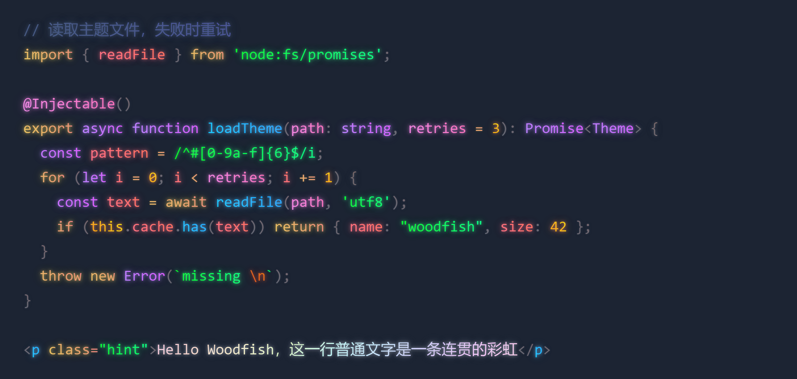

Woodfish Theme adds gradients and glow to code, plus a rainbow cursor and frosted glass. Its five bundled themes each come with hand-tuned gradients; on any other color theme the gradients are derived by the same rules. It works in VS Code, Cursor, Kiro, Windsurf, Trae and VSCodium.

Every picture on this page is rendered by the extension's own code: the code pictures by [render-readme-images.js](apps/vscode-extension/scripts/render-readme-images.js), the effect gallery and the popular themes by [render-readme-effects.js](apps/vscode-extension/scripts/promo/render-readme-effects.js) (the promo video's frame-by-frame renderer; animations are WebP). Only the Codex settings page is a real screenshot.

> The extension UI is in Chinese. Command names below are given in Chinese with an English gloss.

## Preview

**Woodfish Dark**: Bearded Theme Arc colors with the hand-written 5.x gradients.

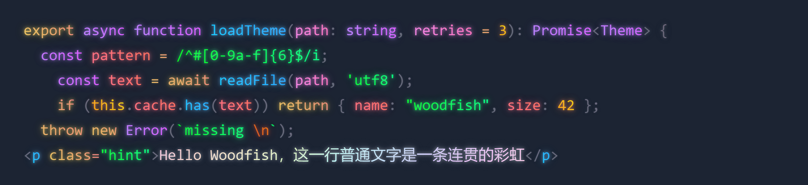

**Woodfish Dracula**: the official Dracula colors, keywords running pink into purple.

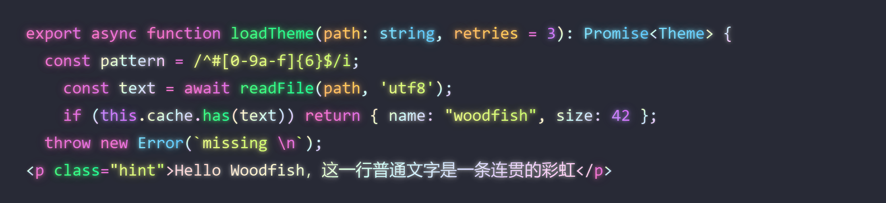

**Woodfish Black**: pure black for OLED screens.

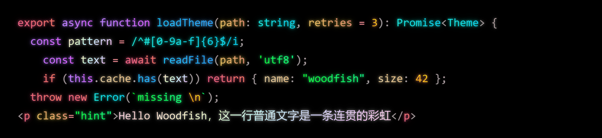

**Woodfish Neon**: neon on deep purple.

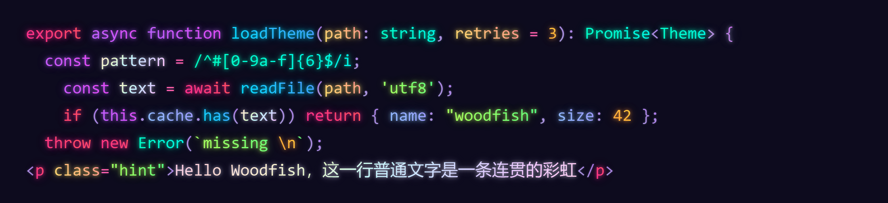

**Woodfish Light**: warm white; gradients go deeper and the glow is a light tint of each hue.

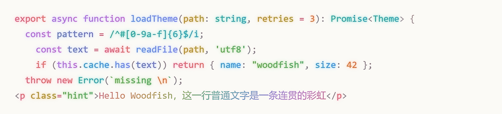

**Any other theme**: VS Code's own Dark Modern as it ships (left) and with Woodfish (right).

| Dark Modern | With Woodfish |
|---|---|
| 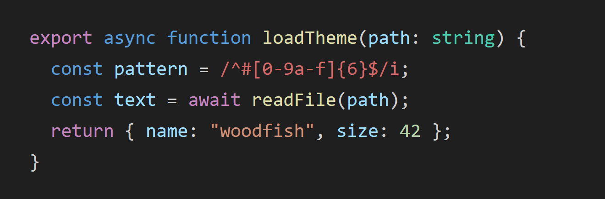 | 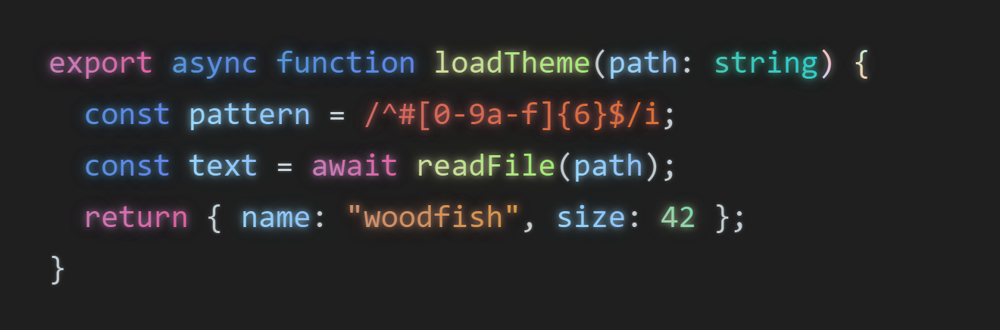 |

**Glow**, off and on:

| Gradient only | Gradient + glow |
|---|---|
| 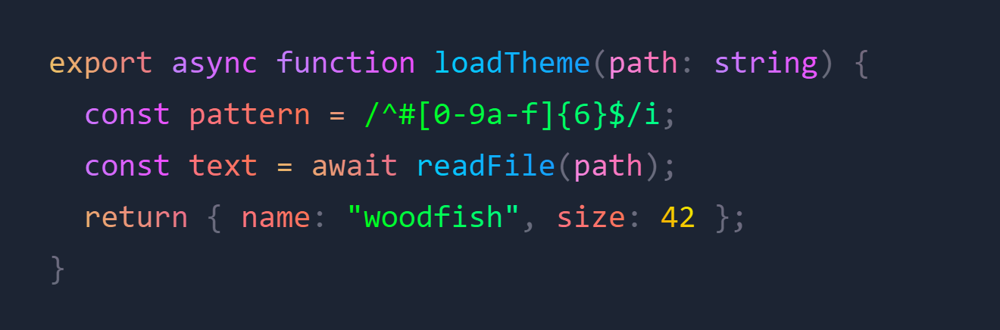 | 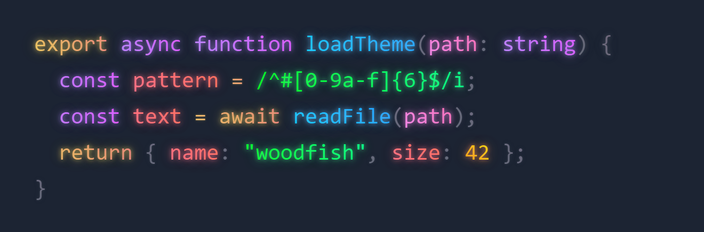 |

**Rainbow cursor**: its colors cycle; these are six moments of one cycle.

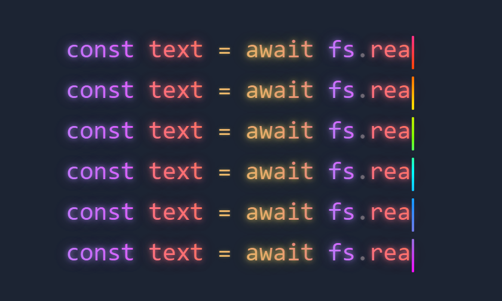

**Frosted glass** on the suggest list (opacity 0.5, 14px blur):

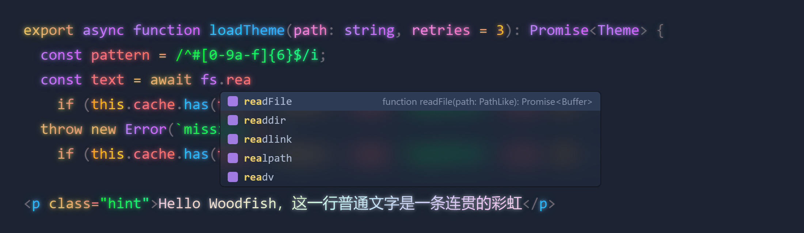

## Effects at a glance

One focused picture per effect; moving effects are short animations. In the Codex desktop app the effects are on once Woodfish is enabled (see [Codex desktop app](#codex-desktop-app)); **Settings → Appearance → Woodfish 外观** toggles each one and exposes all of its parameters. To change only a color, size or speed, add one CSS variable to `user.css` in the effects folder (`%APPDATA%\Woodfish\effects`); the folder's `README.md` lists every variable.

<table>
  <tr>
    <td width="48%">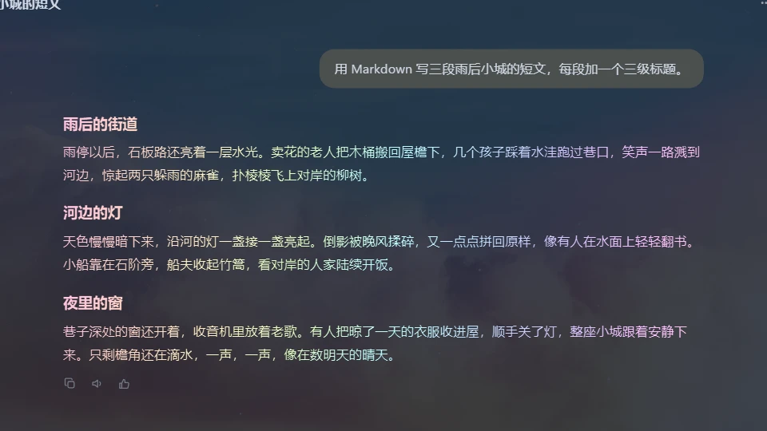</td>
    <td><b>Rainbow replies</b> · Codex<br>The assistant's reply text is a rainbow gradient tuned to the current theme. Pure CSS, so streaming and very long threads cost no extra frame time.<br><sub>Effect <code>rainbow-text</code>; strength and angle: <code>--woodfish-rainbow-text-strength</code>, <code>--woodfish-rainbow-text-angle</code></sub></td>
  </tr>
  <tr>
    <td>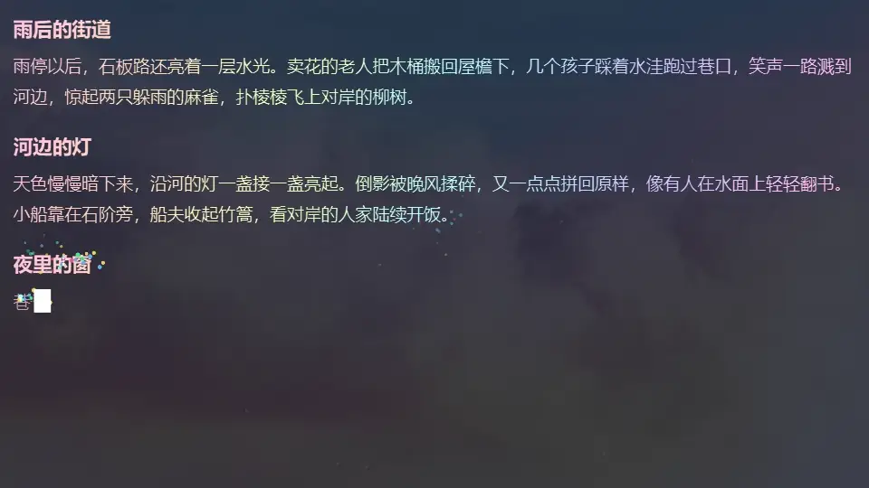</td>
    <td><b>Streaming cursor, trail and fade-in</b> · Codex<br>While the AI writes, a rainbow cursor leads the text with a band trailing behind it, new characters fade in and a few sparks fly. Your typing and the AI's streaming trigger the same effects.<br><sub>Effects <code>stream-cursor</code>, <code>caret-trail</code>, <code>text-reveal</code>; e.g. <code>--woodfish-caret-trail-color: #ff4d4f;</code>, <code>--woodfish-text-reveal-style: blur;</code></sub></td>
  </tr>
  <tr>
    <td>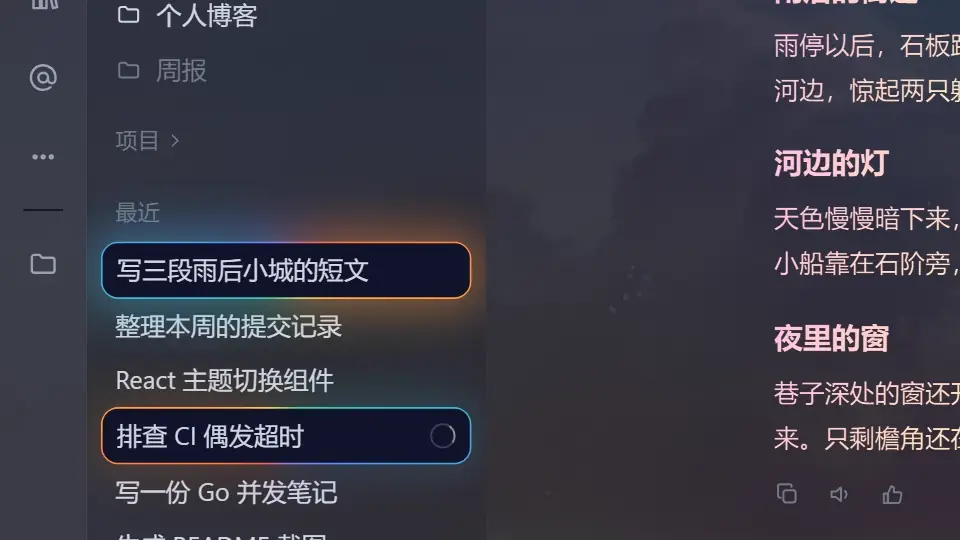</td>
    <td><b>Selected-thread ring</b> · Codex<br>The selected thread in the sidebar wears a slowly turning seven-color ring with a soft halo; running threads glow more faintly.<br><sub>Effect <code>thread-ring</code>; seconds per turn and halo: <code>--woodfish-thread-ring-turn-seconds</code>, <code>--woodfish-thread-ring-halo</code></sub></td>
  </tr>
  <tr>
    <td>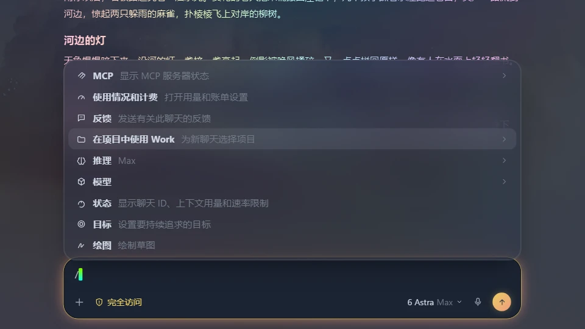</td>
    <td><b>Frosted menus</b> · Codex<br>Menus, the <code>/</code> command list and dialogs are frosted glass that fades in, with the content behind them showing through. For VS Code see <a href="#preview">Preview</a>.<br><sub>Effect <code>glass</code>; blur and opacity: <code>--woodfish-glass-blur</code>, <code>--woodfish-glass-opacity</code></sub></td>
  </tr>
  <tr>
    <td>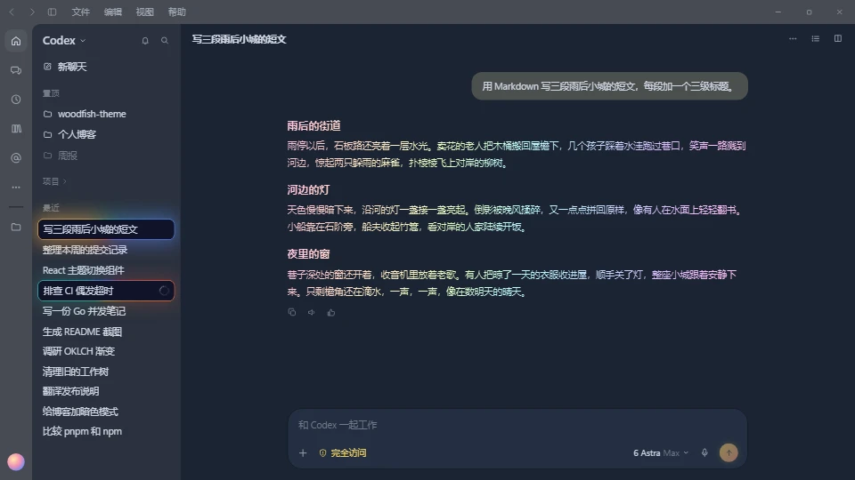<br>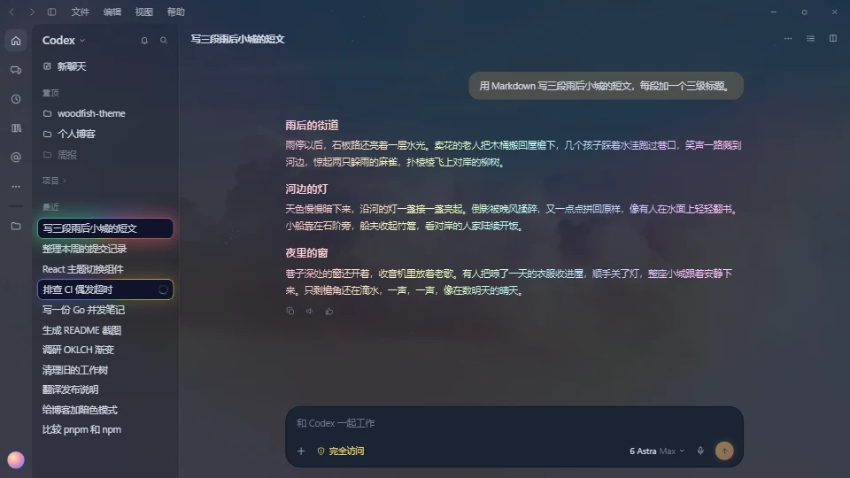</td>
    <td><b>Window background 《彩云》</b> · Codex and VS Code<br>A picture under the whole window, with a frosted sidebar and composer; text stays crisp (top: off, bottom: on). The default is 《彩云》; use your own picture instead.<br><sub>Codex: upload in Settings → Appearance → Woodfish, or <code>woodfish codex background set &lt;picture&gt;</code>; VS Code: run 设置背景图片 (set background picture). Strength: <code>--woodfish-background-opacity</code></sub></td>
  </tr>
  <tr>
    <td>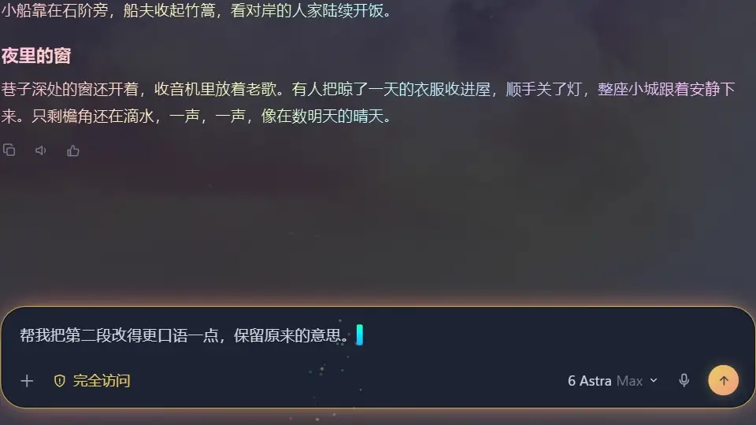</td>
    <td><b>Composer caret and caret trail</b> · Codex<br>The composer gets the same 6px rainbow caret as VS Code; whenever the caret jumps (Home, End, a click) it drags a band behind it, drawn like the VS Code Animations extension.<br><sub>Effects <code>caret</code>, <code>caret-trail</code>; width, length, color: <code>--woodfish-caret-width</code>, <code>--woodfish-caret-trail-length</code>, <code>--woodfish-caret-trail-color</code></sub></td>
  </tr>
  <tr>
    <td>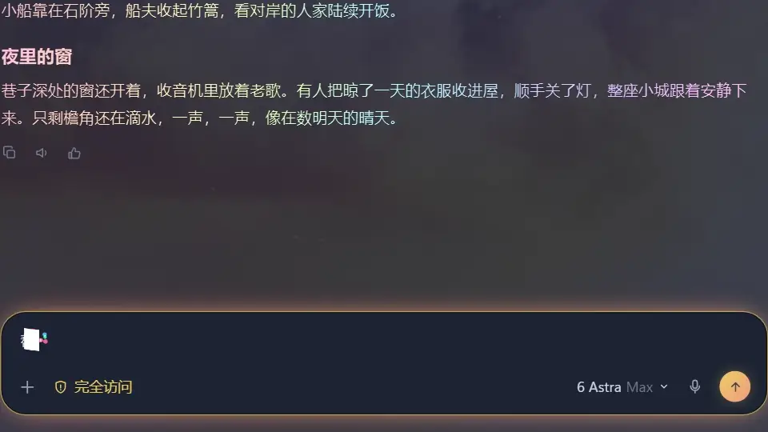</td>
    <td><b>Typing particles</b> · Codex and VS Code<br>Typing and AI streaming throw a burst of theme-colored sparks from the caret; no shake, no combo counter, and fast streams are rate-limited.<br><sub>Effect <code>typing-particles</code>; count, size, colors: <code>--woodfish-typing-particles-count</code>, <code>--woodfish-typing-particles-size</code>, <code>--woodfish-typing-particles-colors: rainbow;</code> (in VS Code: <code>woodfishTheme.typingParticles.*</code>)</sub></td>
  </tr>
  <tr>
    <td>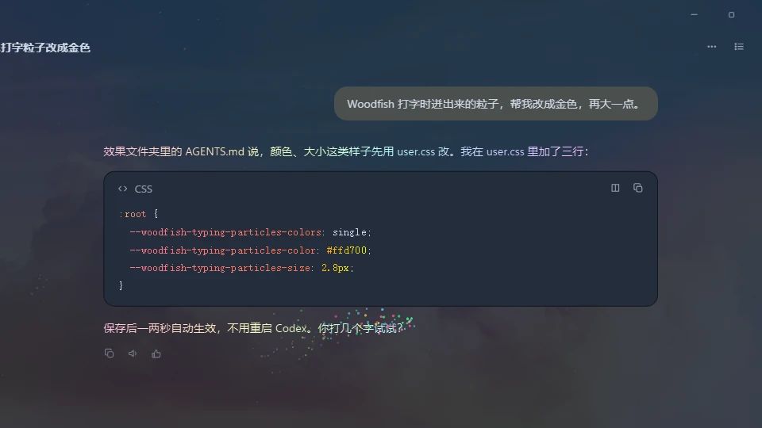</td>
    <td><b>Ask Codex to change an effect</b><br>The effects folder carries an <code>AGENTS.md</code> written for AIs. Tell Codex or Claude “make the typing particles gold and a bit bigger” and it finds the effect, changes variables in <code>user.css</code> first (parameters or code only when needed), and the change reloads by itself.<br><sub>The guide: <code>%APPDATA%\Woodfish\effects\AGENTS.md</code></sub></td>
  </tr>
  <tr>
    <td>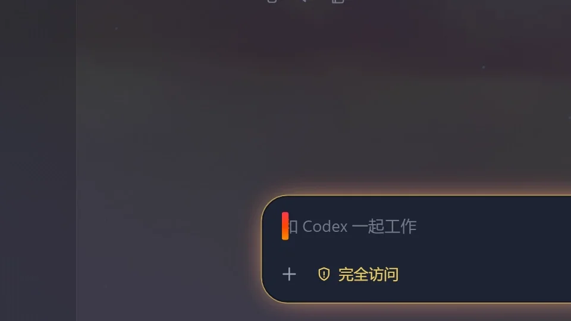</td>
    <td><b>One line of <code>user.css</code></b><br>Every effect parameter is a CSS variable, <code>--woodfish-&lt;effect&gt;-&lt;param&gt;</code>. Put it in the effects folder's <code>user.css</code>: it applies a second or two after saving, survives upgrades, and canvas effects such as trails and particles follow it too. The picture shows the three lines from the row above.<br><sub>The Codex settings page has 打开 user.css (open) and 恢复默认 (reset); the variable list is in the effects folder's <code>README.md</code></sub></td>
  </tr>
  <tr>
    <td>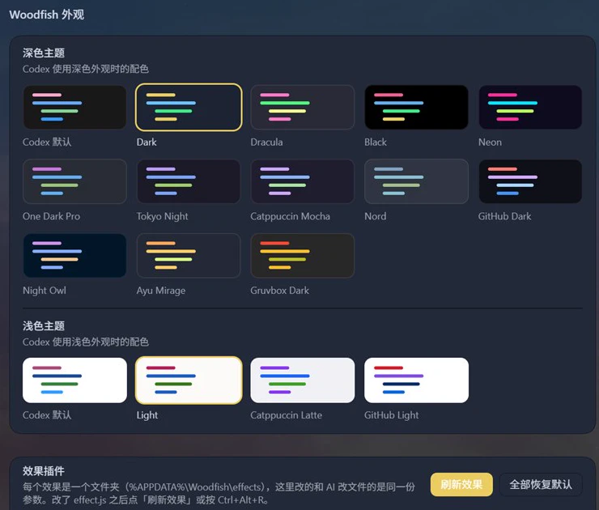</td>
    <td><b>Woodfish 外观 in Codex settings</b><br>Settings → Appearance gains a section: pick a dark and a light theme (15 in total, one click recolors the whole window), one switch per effect, 参数 (parameters) for every slider and color picker, and 刷新效果 (reload effects) / 全部恢复默认 (reset all) at the top.<br><sub>This one is a real screenshot (Codex 26.1013, 2026-11-14)</sub></td>
  </tr>
  <tr>
    <td>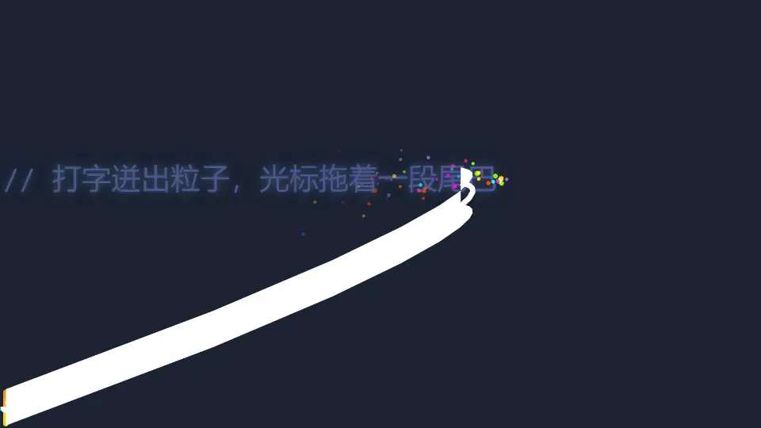</td>
    <td><b>The same effects in VS Code</b><br>The caret trail and typing particles exist in VS Code too, off by default. Both editors share one effects folder, so a change shows up in both.<br><sub>Turn on <code>woodfishTheme.caretTrail.enabled</code> and <code>woodfishTheme.typingParticles.enabled</code> (there is also a mouse trail, <code>woodfishTheme.mouseTrail.enabled</code>)</sub></td>
  </tr>
</table>

## What's new in 7.2

- **Hand-tuned gradients are back**: `Woodfish Dark` restores the hand-written 5.x colors; `Dracula`, `Black`, `Neon` and `Light` are tuned the same way.
- **Better gradients on every other theme**: the derivation follows the same rules, with more vivid ends and a soft rainbow on plain text.
- **Long names and paragraphs no longer break**: VS Code shows a word longer than 50 characters as several pieces, and each piece used to get its own gradient, so colors restarted every 50 characters (most visible in Markdown). It is one gradient now:

  Before 7.2 the rainbow starts over at `and`:

  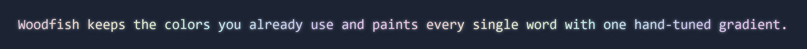

  7.2, one rainbow across the line:

  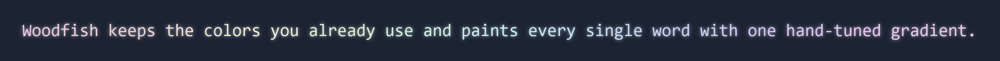

- **Light themes glow in a light color**: the glow used to be the dark text color, which looked like a shadow.

<details>
<summary><strong>What's new in 7.0</strong></summary>

- **Cursor, Kiro, Windsurf, Trae and VSCodium support**: install the same extension from their extension panel (Open VSX).
- **Frosted glass is back**: menus, hovers, suggestions, the command palette, notifications and 7 more surfaces, in a plain blur or an acrylic finish, with a Reveal highlight and entry animations. Cooperates with VS Code 1.143's native frosted glass.
- **System window transparency (experimental)**: macOS vibrancy, Windows 11 acrylic / mica.
- **Three new themes**: `Woodfish Black` (pure black), `Woodfish Neon` (neon) and `Woodfish Light`.
- **Presets and cursor palettes**: 6 built-in presets plus your own; 8 cursor palettes plus custom colors.
- **Uninstalling restores everything**: no more effects left behind after removing the extension.
- **Actionable errors and diagnostics**: write failures explain what to do on each OS; one command copies a diagnostics report for issues.
- **Getting-started walkthrough** on the Welcome page.

</details>

## Installation

- **VS Code**: install from the [VS Code Marketplace](https://marketplace.visualstudio.com/items?itemName=zhongjun.woodfish-theme).
- **Cursor, Kiro, Windsurf, Trae, VSCodium**: search for `Woodfish Theme` in the extension panel (served from [Open VSX](https://open-vsx.org/extension/zhongjun/woodfish-theme)).
- **VSIX**: download it from [GitHub Releases](https://github.com/woodfishhhh/Woodfish-Theme/releases), then run `code --install-extension woodfish-theme-7.2.0.vsix` (use `cursor`, `kiro`, … for other editors).

Pick any color theme, then click **重新加载窗口** (Reload Window) when prompted. The overlay is on by default and never switches your color theme. Click `Woodfish ...` in the status bar for the feature menu.

## Supported editors

| Editor | Based on VS Code | Install from | Tested |
|---|---|---|---|
| VS Code | 1.74+ | VS Code Marketplace | ✅ 1.143 |
| Cursor | 1.128 | Open VSX | ✅ 3.27 |
| VSCodium | 1.143 | Open VSX | ✅ 1.143 |
| Kiro | 1.131 | Open VSX | Package layout verified |
| Windsurf / Devin | 1.126 | Open VSX | Package layout verified |
| Trae / Trae CN | 1.107 | Open VSX | Package layout verified |

"Package layout verified" means the workbench path, CSP, checksums and main-process format in the editor's installer were checked and match the editors that were tested end to end. Remote SSH, WSL and dev containers work too, because Woodfish always runs on the local UI side.

## Effect layers and status bar

| Mark | Layer |
|---|---|
| `A` | Gradient syntax |
| `G` | Text glow |
| `C` | Rainbow cursor |
| `F` | Frosted glass |

`on` means the overlay is installed, `paused` means effects are enabled but the injected payload is missing (run **修复 Woodfish 注入** / Repair), and `off` means the overlay or every effect is disabled.

> [!IMPORTANT]
> Effects are applied by patching the editor's own `workbench.html`, so a window reload is needed after changes. Writes are validated and atomic, with hashed, version-aware backups. Editor updates overwrite the file; run **修复 Woodfish 注入** (Repair) if effects disappear.

## Commands

Search for `Woodfish` in the command palette:

| Command | Purpose |
|---|---|
| 打开 Woodfish 功能菜单 | Feature menu (also the status bar entry) |
| 开启 / 关闭 Woodfish 通用叠层 | Turn the whole overlay on / off |
| 开启/关闭 Woodfish 彩色字体 / 发光字体 | Toggle gradient syntax / glow |
| 开启/关闭彩色光标, 选择彩色光标配色 | Toggle the rainbow cursor, pick a palette |
| 开启/关闭 Woodfish 毛玻璃 | Toggle frosted glass |
| 开启/关闭系统级透明窗口（实验） | Toggle system window transparency |
| 设置背景图片 | Window background: your own picture, the default 《彩云》 or its gradient |
| 选择效果预设, 将当前效果保存为预设 | Apply / save presets |
| 刷新效果 (`Ctrl+Alt+R`), 打开效果文件夹 | Reload the effect plugins without reloading the window, open their folder |
| 修复 Woodfish 注入 | Repair after an editor update |
| 生成 Woodfish 诊断信息 | Copy a diagnostics report |
| 彻底停用 Woodfish 叠层 | Remove every injection, backup and hook |

## Configuration

All settings live under `woodfishTheme.`. In the Settings UI they are grouped into switches, colored text, glow, colored cursor, frosted glass, transparent window (experimental) and advanced, with every effect switch at the top:

```json
{
  "woodfishTheme.overlay.hueShift": 24,
  "woodfishTheme.overlay.lightnessDelta": 0.06,
  "woodfishTheme.glow.intensity": 0.8,
  "woodfishTheme.cursor.gradientStops": ["#ff2d95", "#ffd700", "#00ffff"],
  "woodfishTheme.glass.enabled": true,
  "woodfishTheme.glass.mode": "acrylic"
}
```

### Effect plugins

A mouse trail, a caret trail (both drawn like the VS Code Animations extension: a single-color band, length 12) and typing particles (theme-colored sparks like Power Mode, no shake or combo counter) are pluggable effects under `woodfishTheme.mouseTrail.*`, `woodfishTheme.caretTrail.*` and `woodfishTheme.typingParticles.*`, off by default. Each effect is a folder in `%APPDATA%\Woodfish\effects` (`~/Library/Application Support/Woodfish/effects` on macOS) whose `effect.js` you, or an AI following the folder's `AGENTS.md`, can edit; new folders become new effects. Changes reload by themselves, or run **刷新效果** (`Ctrl+Alt+R`) — no window reload. The Codex app uses the same folder. To change only colors, sizes or lengths, add a CSS variable to `user.css` in the same folder, e.g. `:root { --woodfish-caret-trail-color: #ff4d4f; }`; it loads last, wins over everything else and survives upgrades. The folder's `README.md` lists every variable.

## Troubleshooting

- **"Permission denied" on macOS**: if you started the editor from a terminal (`code .`, `cursor .`), macOS attributes the write to the terminal. Quit the editor completely, open it from the Dock and run Repair. Otherwise allow the editor under System Settings → Privacy & Security → App Management.
- **Windows**: for installs under `Program Files`, run the editor once as administrator, or use the user installer.
- **Linux**: Snap and Flatpak installs are read-only and cannot be patched; use the official `.deb`, `.rpm` or `.tar.gz`.
- **"Your installation appears to be corrupt"**: shown until the editor is fully quit after Woodfish changes `workbench.html`; reloading the window is not enough.
- **Reporting a bug**: run **生成 Woodfish 诊断信息** and paste the report into an [issue](https://github.com/woodfishhhh/Woodfish-Theme/issues).

To restore everything, uninstall the extension and fully restart the editor, or run **彻底停用 Woodfish 叠层** first for an immediate cleanup. If you turned Woodfish on for Codex from this extension, uninstalling it also removes the Codex effects, the logon task and the “Woodfish Codex” Start menu entry, The effect files Woodfish shipped into `%APPDATA%\Woodfish\effects` are deleted too; files you wrote or changed stay (and everything stays while the `woodfish` CLI is still installed). Codex appearance settings and uploaded background pictures remain in `%APPDATA%\Woodfish`; delete that folder if you don't need them. Your `settings.json` is never touched.

## Known limitations

- The minimap is drawn on a canvas and cannot receive gradients.
- Web editors and the remote server side cannot be patched.
- JetBrains IDEs (such as CLion) and Visual Studio are not based on VS Code and are not supported.
- Screenshot extensions such as CodeSnap do not capture Woodfish effects.

## Codex desktop app

Woodfish can also restyle the OpenAI Codex desktop app (Windows Store build). Three ways to get it, all with the same effects:

- **From this extension**: run `Woodfish Theme: 为 Codex 启用 Woodfish` from the command palette (there are commands to turn it off and to uninstall, too). It uses the Codex tool bundled with the extension and the editor's own runtime, so no Node.js install is needed; the debugging-port risk is explained first.
- **Single file**: download `woodfish.exe` from the [GitHub Release](https://github.com/woodfishhhh/Woodfish-Theme/releases/latest) and double-click it; nothing else to install (it is unsigned, so Windows may show "Windows protected your PC": More info → Run anyway).
- **npm**: coming soon. With Node.js 22+ you can already download `woodfish.js` from the same release and run `node woodfish.js codex launch`.

Woodfish never changes or replaces your own Codex shortcuts. With "restore after logon" on, a Codex opened from them is restarted with the debugging port before its window appears: no flicker, the window just shows up two or three seconds later. A separate Start menu entry "Woodfish Codex" starts it with the effects directly.

It never modifies Codex's installation:

- **Native palette**: `woodfish codex theme apply --dark neon --light light` writes Codex's official theme settings (one palette per appearance mode) and opens no ports; `--appearance dark` pins Codex to dark mode.
- **Injected effects**: `woodfish codex launch` adds OKLCH code gradients and glow, frosted floating layers, accent glow, the same 6px rainbow caret as in VS Code, mouse and caret trails and typing particles. Codex is started with a loopback-only debugging port, and the risks are explained before first use. Assistant replies get the rainbow text; while a reply streams, a rainbow cursor follows its end with a trail and new text fades in (AI output triggers the same effects as your typing); the selected sidebar thread gets a turning seven-band spectrum ring with a soft halo.
- **Effect plugins**: Codex keeps only the caret trail; the mouse trail is off by default. Every effect is a folder in `%APPDATA%\Woodfish\effects`. Codex's own **Settings → Appearance → Woodfish 外观** switches between all 15 themes and shows each effect's switch and every parameter; Codex itself can change an effect's code by following the folder's `AGENTS.md`. Saving reloads it, or run `woodfish reload` / press `Ctrl+Alt+R` in Codex, without restarting Codex. Colors, sizes and speeds can also be changed with CSS variables in `user.css` in the same folder (the settings page has 「打开 user.css」).
- **Always on**: `woodfish codex autostart on` registers a hidden logon task (normal rights) that brings the effects back within seconds after Codex restarts or a Store update; `woodfish codex autostart off` or `uninstall` removes it cleanly.

- **Window background**: a picture under the whole window (the editor or thread shows it at 15 %, side panels are frosted glass at 35 % of the theme color, 10px blur). In VS Code run `设置背景图片`; in Codex it is on by default and **Settings → Appearance → Woodfish** uploads (or takes a dropped picture), previews and keeps several; the CLI is `woodfish codex background set <picture>`. Pictures stay on your machine.

Codex++ users can run `woodfish codex install-userscript` instead. See [apps/desktop-cli/README.md](apps/desktop-cli/README.md) (Chinese).

The DeepSeek Harness (dsh) Web UI is themed through a Tampermonkey / Violentmonkey user script: `woodfish dsh userscript`. See [docs/hosts/dsh.md](docs/hosts/dsh.md) (Chinese).

## Bundled popular themes

Besides the five Woodfish themes, the extension ships ten popular MIT-licensed themes unmodified, labelled `Woodfish …`: One Dark Pro, Tokyo Night, Catppuccin Mocha and Latte, Nord, GitHub Dark and Light, Night Owl, Ayu Mirage and Gruvbox Dark. Their gradients and glow are derived from each theme's own colors. Sources and licenses are listed in [THIRD_PARTY_NOTICES](apps/vscode-extension/THIRD_PARTY_NOTICES.md).

<table>
  <tr>
    <td width="50%" align="center">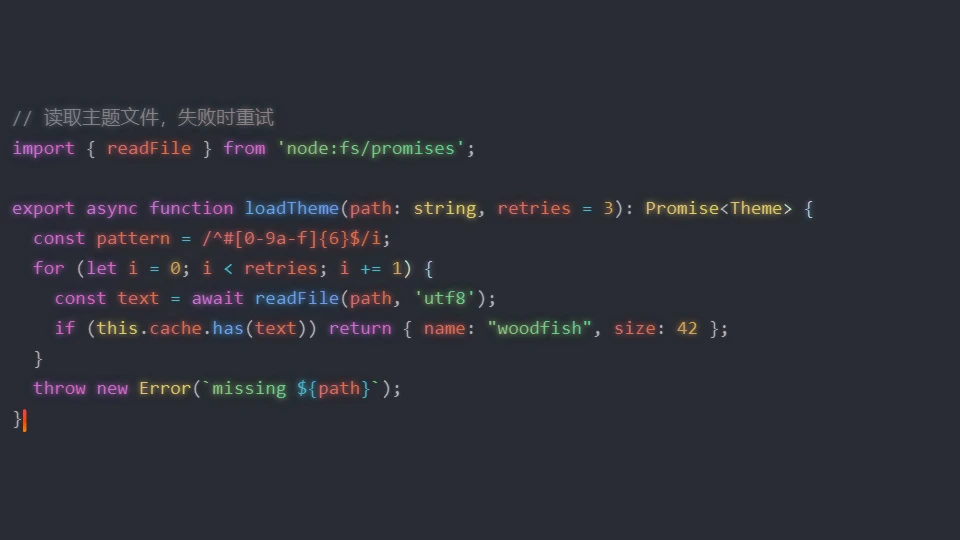<br><sub>Woodfish One Dark Pro</sub></td>
    <td width="50%" align="center">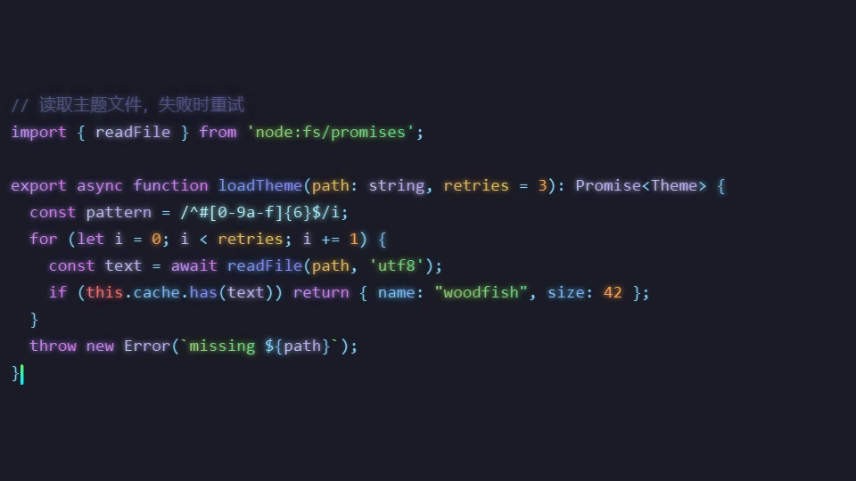<br><sub>Woodfish Tokyo Night</sub></td>
  </tr>
  <tr>
    <td width="50%" align="center">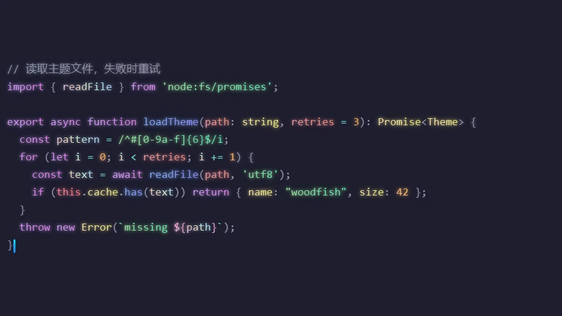<br><sub>Woodfish Catppuccin Mocha</sub></td>
    <td width="50%" align="center">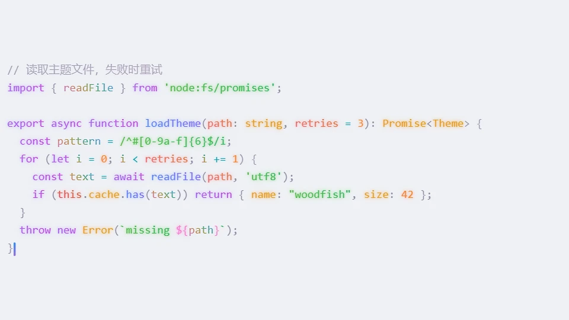<br><sub>Woodfish Catppuccin Latte</sub></td>
  </tr>
  <tr>
    <td width="50%" align="center">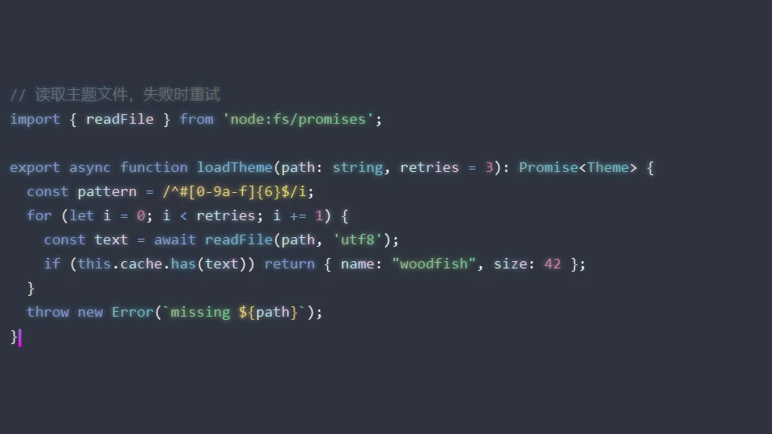<br><sub>Woodfish Nord</sub></td>
    <td width="50%" align="center">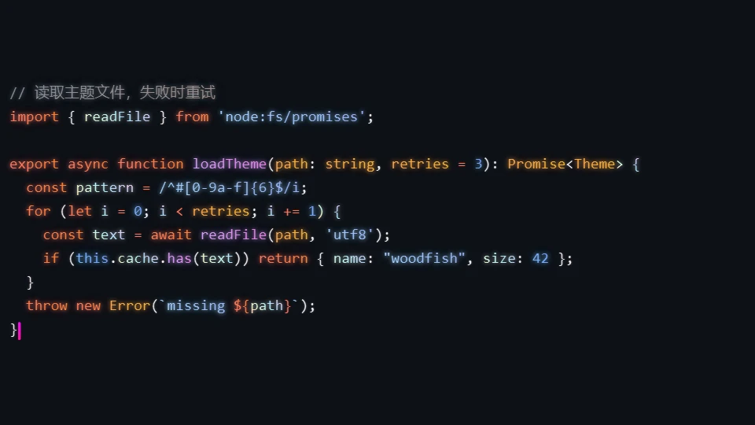<br><sub>Woodfish GitHub Dark</sub></td>
  </tr>
  <tr>
    <td width="50%" align="center">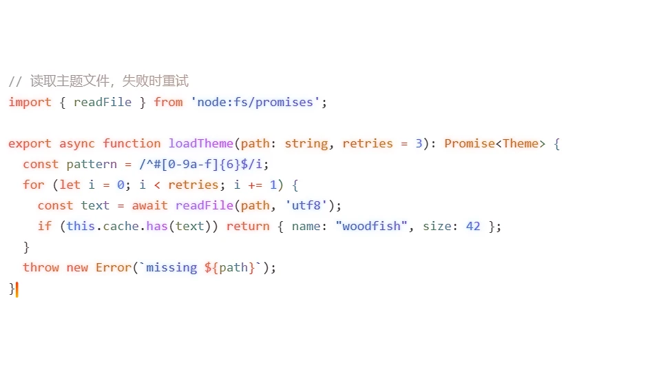<br><sub>Woodfish GitHub Light</sub></td>
    <td width="50%" align="center">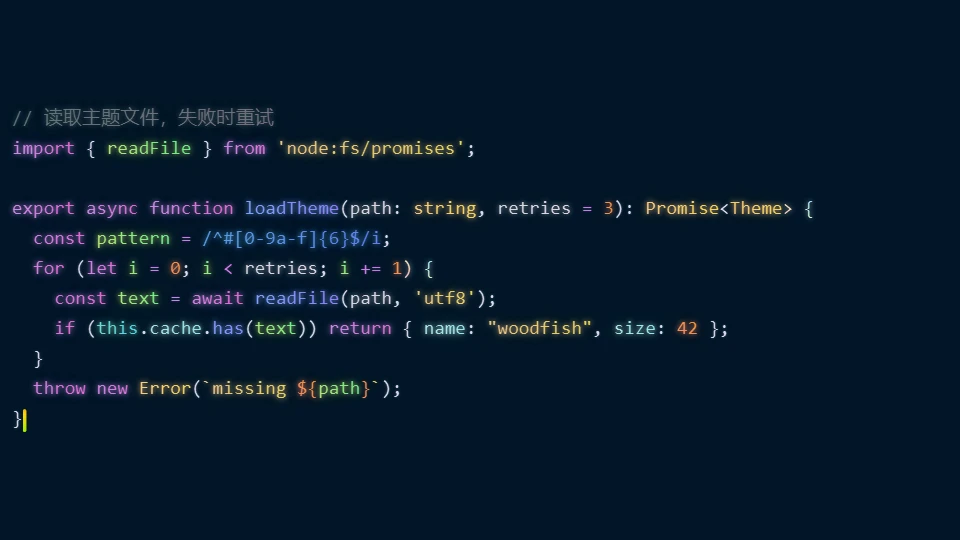<br><sub>Woodfish Night Owl</sub></td>
  </tr>
  <tr>
    <td width="50%" align="center">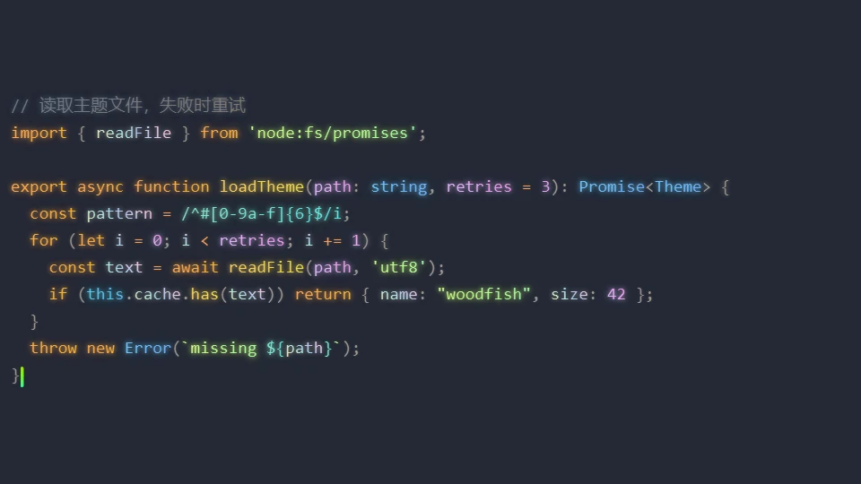<br><sub>Woodfish Ayu Mirage</sub></td>
    <td width="50%" align="center">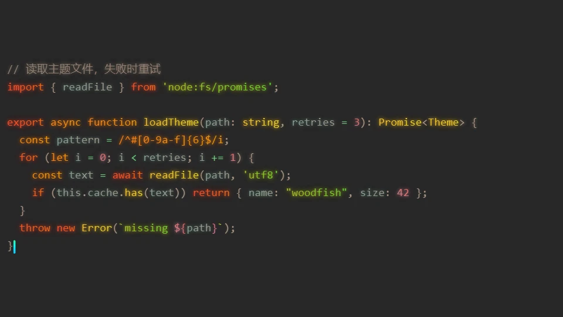<br><sub>Woodfish Gruvbox Dark</sub></td>
  </tr>
</table>

## Development

```bash
pnpm install
pnpm verify
pnpm test:integration
pnpm package
```

The repository is a pnpm workspace monorepo; run the commands above from the root. The VS Code extension lives in `apps/vscode-extension/`, and the host-agnostic color math, gradient derivation, hand-tuned presets, palettes and effect parameters live in `packages/theme-core/` (see [docs/ARCHITECTURE.md](docs/ARCHITECTURE.md)). Themes are generated by `apps/vscode-extension/scripts/generate-themes.js`; the workbench renderer script is built from `apps/vscode-extension/browser/`, and injected CSS lives in `apps/vscode-extension/themes/shared/`. Publishing to Open VSX requires the `OVSX_PAT` environment variable.

## License

Woodfish code is MIT. Bundled theme bases keep their upstream licenses; see [THIRD_PARTY_NOTICES.md](apps/vscode-extension/THIRD_PARTY_NOTICES.md).
