<p align="center">
  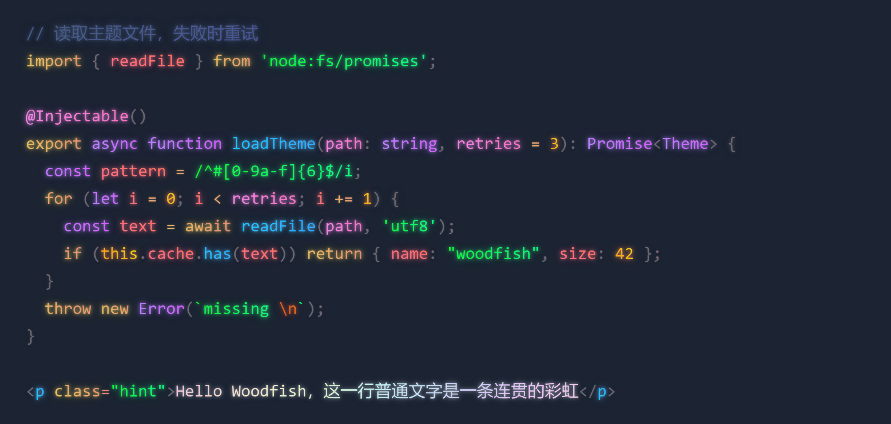
</p>

<p align="center">
  <a href="https://marketplace.visualstudio.com/items?itemName=zhongjun.woodfish-theme"></a>
  <a href="https://open-vsx.org/extension/zhongjun/woodfish-theme"></a>
  <a href="https://marketplace.visualstudio.com/items?itemName=zhongjun.woodfish-theme"></a>
  <a href="./apps/vscode-extension/THIRD_PARTY_NOTICES.md"></a>
  <a href="https://code.visualstudio.com/"></a>
</p>

<p align="center">
  中文 · <a href="https://github.com/woodfishhhh/Woodfish-Theme/blob/HEAD/README.en.md">English</a> ·
  <a href="https://marketplace.visualstudio.com/items?itemName=zhongjun.woodfish-theme">VS Code 安装</a> ·
  <a href="https://open-vsx.org/extension/zhongjun/woodfish-theme">Cursor / Kiro / Trae 安装</a> ·
  <a href="./apps/vscode-extension/docs/TROUBLESHOOTING.md">故障排查</a>
</p>

Woodfish Theme 给代码文字加上渐变和发光，再加上彩虹光标和毛玻璃。自带 5 套 Woodfish 主题（每套都有手工调好的渐变），另附 10 套热门主题；换成别的颜色主题也能用，渐变会照着同样的规律自动算出来。VS Code、Cursor、Kiro、Windsurf、Trae、VSCodium 都能用。

本页所有图片都由扩展实际的渲染脚本和注入 CSS 生成（[生成脚本](./apps/vscode-extension/scripts/render-readme-images.js)）。

## 效果预览

### 五套内置主题

**Woodfish Dark**：Bearded Theme Arc 的配色，渐变是 5.x 时手写的那一套。

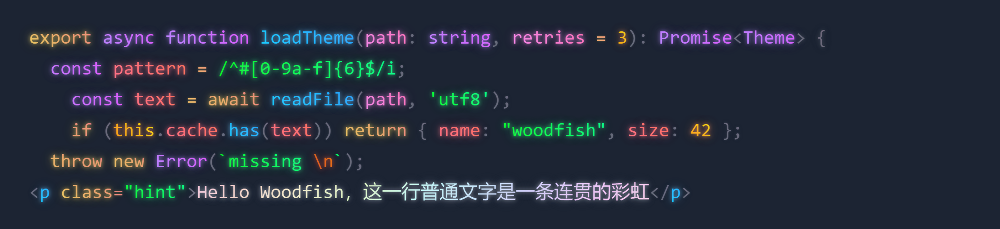

**Woodfish Dracula**：Dracula 官方配色，关键字是粉到紫的渐变。

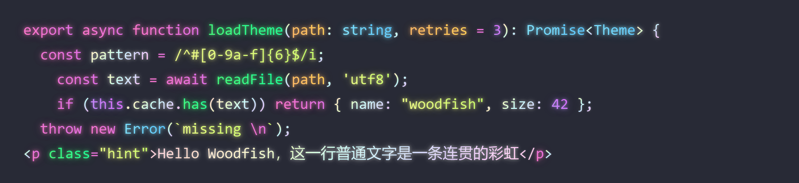

**Woodfish Black**：纯黑背景，适合 OLED 屏。

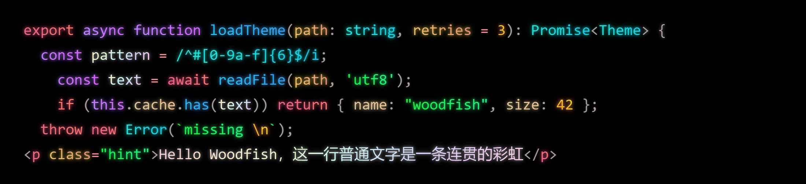

**Woodfish Neon**：深紫底的霓虹配色。

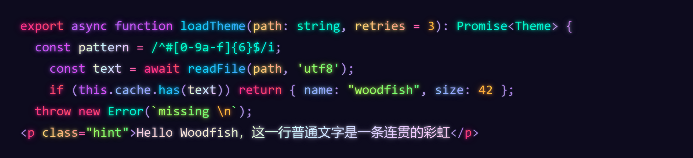

**Woodfish Light**：暖白底的浅色主题，渐变往深处走，发光是同色相的亮色。

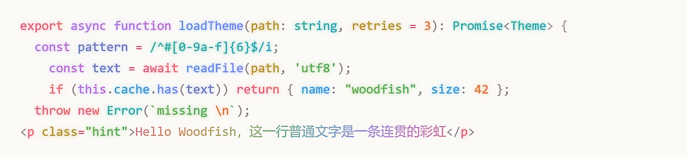

### 十套热门主题

扩展还原样收录了 10 套热门的 MIT 许可主题，名字前加了 `Woodfish`，渐变和发光顺着各自的配色自动生成，效果开关同样适用（关掉就是纯配色）：

| 深色 | 浅色 |
| --- | --- |
| Woodfish One Dark Pro、Woodfish Tokyo Night、Woodfish Catppuccin Mocha、Woodfish Nord、Woodfish GitHub Dark、Woodfish Night Owl、Woodfish Ayu Mirage、Woodfish Gruvbox Dark | Woodfish Catppuccin Latte、Woodfish GitHub Light |

来源与许可见 [THIRD_PARTY_NOTICES](./apps/vscode-extension/THIRD_PARTY_NOTICES.md)。

按 `Ctrl+K Ctrl+T`（macOS 为 `Cmd+K Cmd+T`）切换主题。

### 叠在任意主题上

不用内置主题也行。下面是 VS Code 自带的 Dark Modern，左边是原样，右边开了 Woodfish：渐变从每个词原来的颜色出发，沿色环转到更鲜艳的颜色，读起来不比原色费劲。

<table>
  <tr>
    <td width="50%">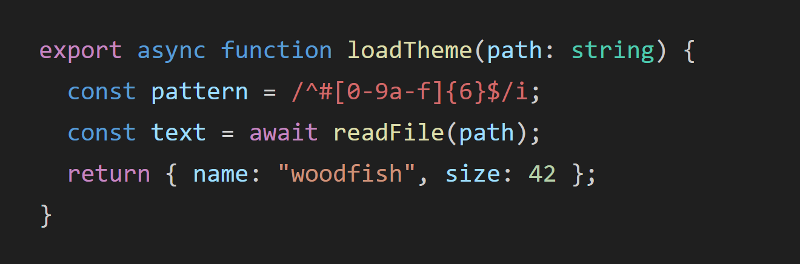</td>
    <td width="50%">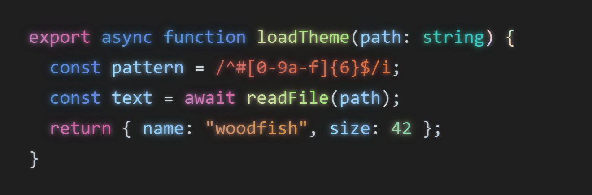</td>
  </tr>
  <tr>
    <td align="center">Dark Modern 原样</td>
    <td align="center">开启 Woodfish</td>
  </tr>
</table>

## 7.2 有什么新东西

- **特调渐变回来了**：`Woodfish Dark` 恢复 5.x 手写的那套颜色，`Dracula`、`Black`、`Neon`、`Light` 也按同样的手法调了一遍。
- **其他主题的渐变更好看**：自动计算改成照着特调的规律来，终点更鲜艳，普通文字是一条淡彩虹。
- **长名字、长段落不再断色**：VS Code 会把超过 50 个字符的词拆成几段显示，以前每段各算一次渐变，所以每隔 50 个字颜色就从头开始（Markdown 里最明显）。现在整段是一条渐变：

  7.1 及以前，彩虹在 `and` 那里又从粉色开始了一遍：

  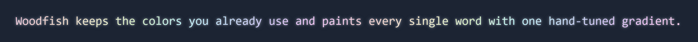

  7.2，从头到尾是一条：

  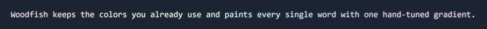

- **浅色主题的发光换成亮色**：以前用文字本身的深色发光，看起来像一圈阴影。

<details>
<summary><strong>7.0 的新功能</strong></summary>

- **支持 Cursor、Kiro、Windsurf、Trae、VSCodium**：同一个扩展，从各自的扩展面板（Open VSX）直接安装。
- **毛玻璃回来了**：菜单、悬浮提示、补全列表、命令面板、通知等 12 类浮层，可选普通模糊或亚克力质感，带 Reveal 光效和入场动画；VS Code 1.143 起与原生毛玻璃协同。
- **系统级透明窗口（实验）**：macOS vibrancy、Windows 11 亚克力 / 云母。
- **三套新主题**：`Woodfish Black`（纯黑）、`Woodfish Neon`（霓虹）、`Woodfish Light`（浅色）。
- **效果预设和光标配色**：6 套内置预设，可以保存自己的组合；8 套光标配色，也能自定义颜色。
- **卸载即还原**：卸载扩展后自动清理所有注入，不会再出现“卸载了光标还在”。
- **出错时说人话**：写入失败会按系统给出中文的处理办法；新增一键生成诊断信息，方便提 issue。
- **新手引导**：首次安装后在“欢迎”页里一步步带你开启效果。

</details>

## 它提供什么

- **渐变语法**：内置主题用特调，其他主题自动计算。运行时读取每个词的实际颜色，不依赖固定的 `mtk` 编号。
- **发光**：独立开关，强弱可调。深色主题用文字本身的颜色发光，浅色主题用同色相的亮色。
- **彩虹光标**：颜色、循环速度、圆角、尾迹模糊和透明度都能调，8 套配色可选。
- **毛玻璃**：12 类浮层，底色取自当前主题，不用改 `workbench.colorCustomizations`。
- **系统级透明窗口（实验）**：macOS vibrancy、Windows 11 亚克力 / 云母。
- **效果预设**：6 套内置组合，也能把自己调好的参数存成预设。
- **安全恢复**：写入前保存并校验备份，失败自动回滚；卸载后自动还原。
- **动效降级**：遵循系统的“减少动态效果”“降低透明度”和 `workbench.reduceMotion`。
- **状态栏**：显示 `on / paused / off`，用 `A / G / C / F` 标出正在生效的效果层。

### 发光

<table>
  <tr>
    <td width="50%">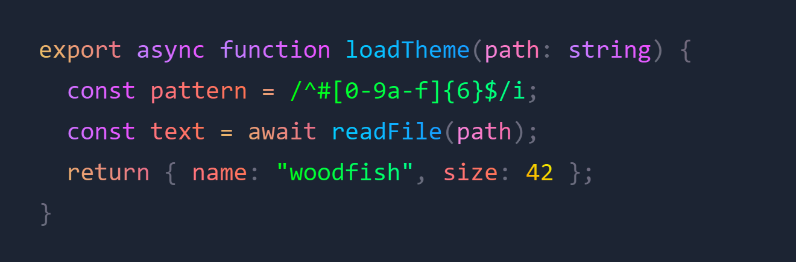</td>
    <td width="50%">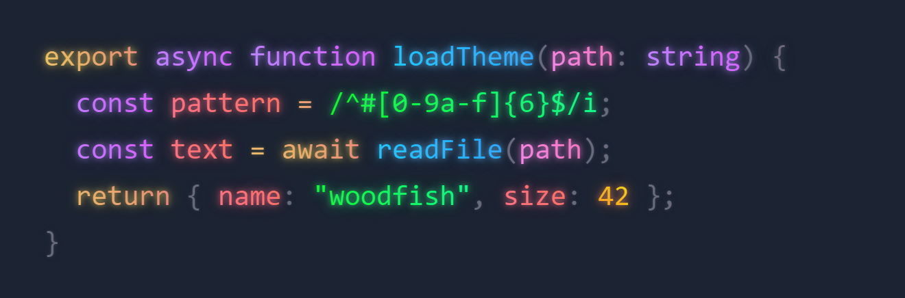</td>
  </tr>
  <tr>
    <td align="center">只开渐变</td>
    <td align="center">渐变 + 发光（默认强度）</td>
  </tr>
</table>

### 彩虹光标

光标的颜色会循环变化。下图是同一个光标在一个循环里的 6 个时刻：

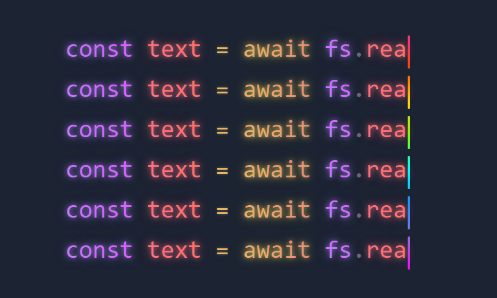

## 三步开始

1. 安装 **Woodfish Theme**：
   - VS Code：从 [VS Code Marketplace](https://marketplace.visualstudio.com/items?itemName=zhongjun.woodfish-theme) 安装。
   - Cursor、Kiro、Windsurf、Trae、VSCodium：在扩展面板里搜索 `Woodfish Theme`（来自 [Open VSX](https://open-vsx.org/extension/zhongjun/woodfish-theme)）。
2. 选一个你喜欢的颜色主题，想要特调效果就选 Woodfish Dark / Dracula / Black / Neon / Light 这五套。
3. 点右下角弹出的 **重新加载窗口**。

叠层默认开启，不会替你切换颜色主题。点击状态栏右下角的 `Woodfish ...` 打开功能菜单，可以开关各项效果、选预设、开毛玻璃。

<details>
<summary><strong>手动安装 VSIX</strong></summary>

从 [GitHub Releases](https://github.com/woodfishhhh/Woodfish-Theme/releases) 下载 `.vsix` 后运行（Cursor 把 `code` 换成 `cursor`，其他编辑器同理）：

```bash
code --install-extension woodfish-theme-7.2.0.vsix
```

</details>

## 支持的编辑器

| 编辑器 | 基于 VS Code | 从哪里安装 | 实测 |
|---|---|---|---|
| VS Code | 1.74+ | [VS Code Marketplace](https://marketplace.visualstudio.com/items?itemName=zhongjun.woodfish-theme) | ✅ 1.143 |
| Cursor | 1.128 | 扩展面板（Open VSX） | ✅ 3.27 |
| VSCodium | 1.143 | 扩展面板（Open VSX） | ✅ 1.143 |
| Kiro | 1.131 | 扩展面板（Open VSX） | 结构已核对 |
| Windsurf / Devin | 1.126 | 扩展面板（Open VSX） | 结构已核对 |
| Trae / Trae CN | 1.107 | 扩展面板（Open VSX） | 结构已核对 |

“结构已核对”表示已逐项检查过该编辑器安装包里的 workbench 路径、安全策略（CSP）、校验和与主进程格式，与实测通过的编辑器一致。提示信息会显示你正在用的编辑器名字，比如“请重新加载 Cursor”。Remote SSH、WSL 和开发容器里同样有效：Woodfish 始终运行在本地界面这一侧。

## 毛玻璃

运行 `Woodfish Theme: 开启/关闭 Woodfish 毛玻璃`，或在功能菜单里打开。

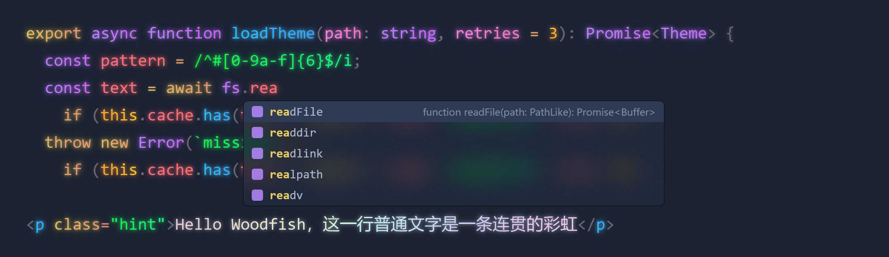

<sub>补全列表，毛玻璃透明度 0.5、模糊 14px</sub>

- **两种质感**：`blur` 是普通模糊加噪点，开销最低；`acrylic` 是 SVG 亚克力滤镜，质感更好。
- **作用范围**：菜单、悬浮提示、补全列表、命令面板、通知、查找框、下拉框、面包屑、调试工具栏、粘性滚动、面板标题、对话框，可以在 `woodfishTheme.glass.targets` 里逐项取舍。
- **Reveal 光效**：鼠标划过列表、按钮、标签页时跟随指针的柔光。
- **系统级透明窗口（实验）**：运行 `开启/关闭系统级透明窗口（实验）`，让整个窗口透出桌面。它会在编辑器的 `out/main.js` 开头加一行受保护的加载语句，需要完全退出编辑器才会生效，编辑器更新后要重新开启。目前只支持 macOS 和 Windows 11。

## 窗口背景

运行 `Woodfish Theme: 设置背景图片`，选一张自己的图片（JPG、PNG 或 WebP），或者用默认背景《彩云》、彩云渐变。图片铺在窗口底下，编辑器直接透出背景，侧边栏和面板用毛玻璃叠在上面，文字始终清楚。

- **默认观感**：背景图透出 15%，铺满居中；侧边栏和面板按 35% 的主题色叠在上面，模糊 10px、饱和度 150%，外加 10% 的亮度层。深色主题被压暗，浅色主题被提亮，颜色都跟着当前主题走。
- **可调项**：`woodfishTheme.background.opacity`（透明度）、`woodfishTheme.background.blur`（模糊）、`woodfishTheme.background.mask`（遮罩，越大越不透明），`woodfishTheme.background.enabled` 开关。改完重新加载窗口。
- **图片放在哪**：选中的图片会复制到 Woodfish 自己的存储目录，原图之后可以删除或移动。长边超过 2560 像素或体积超过 3 MB 的图片会先缩小并转成 WebP。
- 背景是窗口底下的一张静态图，滚动和输入时不做额外计算。

默认背景《彩云》由作者 woodfish 制作。

## 效果插件

鼠标拖尾、光标拖尾、打字粒子是可插拔的效果插件，在设置的「效果插件」一节里打开（默认关闭）：

- **鼠标拖尾** `woodfishTheme.mouseTrail.*`、**光标拖尾** `woodfishTheme.caretTrail.*`：照抄 VS Code Animations 插件的画法，指针或光标身后拖一条单色带子（默认白色，长度 12，可改成跟随主题）。
- **打字粒子** `woodfishTheme.typingParticles.*`：打字时从光标处迸出一簇主题色的光点，像 Power Mode，没有震动和连击计数。
- 每个效果是 `%APPDATA%\Woodfish\effects`（macOS 在 `~/Library/Application Support/Woodfish/effects`）里的一个文件夹，`effect.js` 就是实现，可以直接改，也可以让 AI 照文件夹里的 `AGENTS.md` 帮你改，或者新建一个效果。改了文件或设置会自动刷新，也可以运行 `Woodfish Theme: 刷新效果`（`Ctrl+Alt+R`），**不用重新加载窗口**。同一个文件夹也给 Codex 用，改一次两边都变。只想换颜色、粗细、长度：在同一文件夹的 `user.css` 里写一行 CSS 变量，例如 `:root { --woodfish-caret-trail-color: #ff4d4f; }`，它最后加载、优先级最高，升级不覆盖；全部变量见文件夹里的 `README.md`。
- 只在有效果要画时才逐帧绘制，窗口在后台或开了“减少动态效果”时暂停。

## 效果预设

运行 `Woodfish Theme: 选择效果预设`：

| 预设 | 说明 |
|---|---|
| Woodfish 默认 | 渐变 + 发光 + 彩色光标，所有参数恢复默认 |
| 柔和护眼 | 更小的色相偏移、更弱的发光，适合长时间写代码 |
| 霓虹全开 | 更强的渐变和发光、更快的光标，加上毛玻璃和 Reveal |
| 毛玻璃 | 默认代码效果 + 亚克力毛玻璃 |
| 专注模式 | 只保留彩色光标，代码颜色交给主题 |
| 性能优先 | 保留渐变，关掉发光、光标尾迹和毛玻璃 |

调好一套自己喜欢的参数后，运行 `将当前效果保存为预设` 就能随时切回来。光标颜色可以用 `选择彩色光标配色` 单独换：跟随主题、彩虹、Dracula、赛博朋克、极光、日落、樱花、单色白，或者输入自己的颜色。

## 效果层与状态

```text
任意颜色主题
    └── Woodfish 通用叠层
        ├── A  渐变语法
        ├── G  文字发光
        ├── C  彩虹光标
        └── F  毛玻璃
```

| 状态栏 | 含义 |
| --- | --- |
| `on` | 叠层已开启，并检测到当前的注入内容 |
| `paused` | 效果开着，但注入内容缺失，通常运行一次“修复 Woodfish 注入”即可 |
| `off` | 叠层总开关关闭，或所有效果都关闭 |
| `A / G / C / F` | 渐变语法 / 文字发光 / 彩虹光标 / 毛玻璃已开启 |

> [!IMPORTANT]
> 效果是通过修改编辑器自带的 `workbench.html` 实现的，切换效果后需要重新加载窗口。写入前会做校验后的原子替换，并保存带哈希、路径和版本信息的备份。编辑器更新会覆盖这个文件，效果消失时运行 `Woodfish Theme: 修复 Woodfish 注入`。

<details>
<summary><strong>常用命令</strong></summary>

在命令面板（`Ctrl+Shift+P`）里搜索 `Woodfish`：

| 命令 | 用途 |
| --- | --- |
| `打开 Woodfish 功能菜单` | 按分组列出所有开关，状态栏入口也是它 |
| `开启 / 关闭 Woodfish 通用叠层` | 整体开关，关闭后保留参数 |
| `开启/关闭 Woodfish 彩色字体` | 切换渐变语法 |
| `开启/关闭 Woodfish 发光字体` | 切换文字发光 |
| `开启 Woodfish 彩色光标` / `开启/关闭彩色光标` | 启用并配置 / 快速切换彩虹光标 |
| `选择彩色光标配色` | 换光标颜色 |
| `开启/关闭 Woodfish 毛玻璃` | 切换浮层毛玻璃 |
| `开启/关闭系统级透明窗口（实验）` | 让整个窗口透出桌面 |
| `选择效果预设` / `将当前效果保存为预设` | 一键切换 / 保存参数组合 |
| `打开 Woodfish 设置` | 跳到设置页 |
| `刷新效果`（`Ctrl+Alt+R`） / `打开效果文件夹` | 重新加载效果插件（不重载窗口） / 打开效果文件夹 |
| `修复 Woodfish 注入` | 编辑器更新后效果消失时使用 |
| `生成 Woodfish 诊断信息` | 复制一份环境报告，提 issue 时直接粘贴 |
| `彻底停用 Woodfish 叠层` | 移除全部注入、备份和系统级窗口钩子 |

</details>

## 配置示例

所有设置都以 `woodfishTheme.` 开头，也可以运行 `打开 Woodfish 设置` 在图形界面里调：设置页分成“开关、彩色字体、发光字体、彩色光标、毛玻璃、透明窗口（实验）、高级”几组，所有效果开关都在最上面。下面是一组偏克制、带毛玻璃的配置：

```json
{
  "woodfishTheme.overlay.hueShift": 24,
  "woodfishTheme.overlay.lightnessDelta": 0.08,
  "woodfishTheme.glow.intensity": 0.8,
  "woodfishTheme.cursor.animationDuration": 8,
  "woodfishTheme.cursor.gradientStops": ["#ff2d95", "#ffd700", "#00ffff"],
  "woodfishTheme.cursor.glowOpacity": 0.55,
  "woodfishTheme.glass.enabled": true,
  "woodfishTheme.glass.mode": "acrylic",
  "woodfishTheme.glass.opacity": 0.75,
  "woodfishTheme.glass.reveal": true
}
```

| 设置 | 范围 | 默认 | 作用 |
|---|---|---|---|
| `overlay.hueShift` | `0 - 180` 度 | `32` | 渐变从原色沿色环转到终点的角度 |
| `overlay.lightnessDelta` | `0 - 0.5` | `0.12` | 渐变终点最多变亮或变暗多少 |
| `overlay.neutralChroma` | `0 - 0.4` | `0.075` | 普通文字上那条彩虹的浓淡 |
| `overlay.angle` | `0 - 360` 度 | `45` | 渐变方向，`45` 是从左下到右上 |
| `glow.intensity` | `0.1 - 3` | `1` | 发光强度倍率 |
| `cursor.animationDuration` | `1 - 60` 秒 | `8` | 光标颜色循环一圈的时间 |

- `overlay.*` 这四项只影响自动计算的渐变；内置主题的特调渐变自带颜色和方向。
- `glass.blur` / `glass.saturate` / `glass.opacity` / `glass.noise`：毛玻璃的模糊半径、饱和度、底色不透明度和颗粒强度。
- `syntaxGradient.customRules`、`glow.customRules`、`cursor.customRules`：在对应效果层之后追加自己的 CSS。

## 卸载与恢复

- **直接卸载就行**：卸载扩展后，下次完全重启编辑器时会自动还原 `workbench.html`、校验和与系统级窗口钩子。
- **想立刻恢复原样**：先运行 `彻底停用 Woodfish 叠层` 再卸载。
- Woodfish 只清理自己写入的内容，其他扩展的注入不会被改动。

## 排查问题

<details>
<summary><strong>效果没有出现</strong></summary>

确认右下角状态栏显示 `Woodfish on`，并且重新加载过窗口。显示 `paused` 时运行 `修复 Woodfish 注入`。

</details>

<details>
<summary><strong>编辑器更新后效果消失</strong></summary>

编辑器更新会覆盖 `workbench.html`，运行 `修复 Woodfish 注入` 后重新加载窗口。

</details>

<details>
<summary><strong>提示“没有权限写入”</strong></summary>

- macOS：如果是在终端里用 `code .`、`cursor .` 启动的，macOS 会把写入算到终端头上。请完全退出编辑器，改从程序坞打开后运行 `修复 Woodfish 注入`。仍然不行的话，到“系统设置 → 隐私与安全性 → App 管理”里允许这个编辑器。
- Windows：安装在 `Program Files` 时，以管理员身份运行一次编辑器再修复，或者改用“用户安装版”。
- Linux：Snap、Flatpak 版的安装目录是只读的，无法注入，请改用官方 `.deb`、`.rpm` 或 `.tar.gz`。

</details>

<details>
<summary><strong>提示“安装似乎损坏”</strong></summary>

开启、修改或移除效果后，在完全退出编辑器之前这条提示会一直出现，重新加载窗口不会消失。完全退出再打开就好，这是编辑器只在启动时读取校验和导致的。

</details>

提 issue 前运行 `生成 Woodfish 诊断信息`，内容会复制到剪贴板，直接粘贴到 [issue](https://github.com/woodfishhhh/Woodfish-Theme/issues) 里。更多排查步骤见 [故障排查指南](./apps/vscode-extension/docs/TROUBLESHOOTING.md)。

## 已知限制

- **小地图（minimap）没有渐变**：小地图是 canvas 绘制的，CSS 改不了。
- **网页版和 Remote 服务器端**：效果只能注入到桌面版编辑器的本地界面。
- **JetBrains 系列（如 CLion）、Visual Studio**：它们不是基于 VS Code 的，Woodfish 无法支持。
- **截图类扩展（如 CodeSnap）**：截图里不会带上 Woodfish 的效果。

## Codex 桌面端

Woodfish 也能为 OpenAI Codex 桌面端（Windows 商店版）换上配色和效果。三种装法效果相同，任选一种：

- **在这个扩展里一键启用**：命令面板运行 `Woodfish Theme: 为 Codex 启用 Woodfish`（停用、卸载也各有一条命令）。用扩展自带的 Codex 工具和编辑器自带的运行时，不用另装 Node.js；第一次会先说明调试端口的风险。
- **下载单文件**：[GitHub Release](https://github.com/woodfishhhh/Woodfish-Theme/releases/latest) 里的 `woodfish.exe`，双击即可，什么都不用装（没有代码签名，Windows 可能提示“已保护你的电脑”，点“更多信息 → 仍要运行”）。
- **npm**：`npx woodfish codex launch`，或 `npm i -g woodfish`（需要 Node.js 22+）。

Woodfish 不会修改、替换你原来的 Codex 快捷方式。开了“登录后自动恢复”时，用原来的快捷方式打开的 Codex 会在窗口出现前被带调试端口重启一次，看不到闪烁，只是比平时晚两三秒出窗口；想省掉这一步，可以在开始菜单另加一个直接带效果启动的“Woodfish Codex”。

它不修改 Codex 的安装文件，有两种方式：

- **原生配色**：`woodfish codex theme apply --dark neon --light light`，写入 Codex 官方的主题设置，深色和浅色各一套，不开任何端口；加 `--appearance dark` 可把 Codex 固定为深色。
- **注入效果**：`woodfish codex launch`，加上代码块渐变与发光、浮层毛玻璃、强调色光晕、和 VS Code 一样的 6px 彩虹光标、鼠标和光标拖尾、打字粒子。需要以本机调试端口启动 Codex，首次使用前会说明风险。助手回复是彩虹渐变字；AI 吐字时末尾跟着一根彩虹光标、身后拖一段拖尾、新字轻轻淡入（AI 吐字和你打字触发的是同一套效果）；选中的会话外圈是一道旋转的七色光谱环加柔光晕。
- **效果插件**：Codex 里只留文字光标的拖尾，鼠标拖尾默认关闭。每个效果是 `%APPDATA%\Woodfish\effects` 里的一个文件夹，在 Codex 的 **设置 → 外观 → Woodfish 外观** 里能切换 15 套主题、开关每个效果、调它的全部参数；也可以让 Codex 照文件夹里的 `AGENTS.md` 改效果代码。保存即刷新，或 `woodfish reload` / Codex 里按 `Ctrl+Alt+R`，不用重启 Codex。颜色、粗细、速度这类样子也能在同一文件夹的 `user.css` 里用 CSS 变量改（设置页有「打开 user.css」）。
- **一直生效**：`woodfish codex autostart on` 注册一个登录时运行的后台任务（无窗口、普通权限）。Codex 重启或商店更新后，效果会在几秒内自动回来；`woodfish codex autostart off` 或 `woodfish codex uninstall` 干净移除。

- **窗口背景**：默认铺上《彩云》，侧栏和输入框是毛玻璃。在 **设置 → 外观 → Woodfish** 里点“上传图片”或把图片拖进窗口就能换成自己的，实时预览，可调透明度、模糊、遮罩，保存多张随时切换；命令行是 `woodfish codex background set <图片>`。图片只存在本机。

已经在用 Codex++ 的话，也可以运行 `woodfish codex install-userscript`，以用户脚本的形式加载。详见 [Woodfish 桌面工具](./apps/desktop-cli/README.md)。

## DeepSeek Harness（dsh）Web 版

dsh 的 Web 版（`dsh web`，本机 `127.0.0.1:3080`）可以通过油猴用户脚本换上同样的主题和效果：`woodfish dsh userscript` 输出脚本路径，装进 Tampermonkey / Violentmonkey 即可。详见 [dsh 适配说明](./docs/hosts/dsh.md)。

## 本地开发

```bash
pnpm install
pnpm compile
pnpm test
pnpm test:integration
pnpm lint
pnpm format:check
pnpm verify
pnpm package
```

仓库是 pnpm workspace monorepo，以上命令都在根目录运行。VS Code 扩展位于 `apps/vscode-extension/`，与宿主无关的颜色算法、渐变计算、特调表和调色板位于 `packages/theme-core/`，结构与边界见 [仓库结构](./docs/ARCHITECTURE.md)。

`pnpm test:integration` 会启动隔离的 VS Code 扩展宿主，验证开启、关闭和工作台恢复。扩展入口是 `apps/vscode-extension/src/extension.ts`；主题由 `apps/vscode-extension/scripts/generate-themes.js` 生成（`pnpm themes:generate`），渲染端脚本源码在 `apps/vscode-extension/browser/`（`pnpm runtime:build`），注入用 CSS 在 `apps/vscode-extension/themes/shared/`。README 里的图片由 `apps/vscode-extension/scripts/render-readme-images.js` 生成，改了渐变或效果后重跑一次。发布到 Open VSX 需要先设置环境变量 `OVSX_PAT`。

## 项目信息

- [更新日志](./apps/vscode-extension/CHANGELOG.md)
- [参与贡献](./docs/CONTRIBUTING.md)
- [提交问题](https://github.com/woodfishhhh/Woodfish-Theme/issues)
- [许可与第三方主题声明](./apps/vscode-extension/THIRD_PARTY_NOTICES.md)
