# DeepSeek Harness（dsh）Web 版适配说明

使用方法见 [apps/cli/README.md](../../apps/cli/README.md#deepseek-harnessdsh-web-版)。本文记录实测结论，供维护 `apps/dsh-web` 时参考。

实测环境：Windows 11，`@deepseek-ai/dsh` **0.2.2-rc.5**（npm 的 `latest`，需要 Node.js ≥ 24.9；`alpha` 标签上另有 0.2.3-alpha.2，未测），Chromium 内核浏览器，实测日期 2026-11-25。0.2.2-rc.1（2026-11-13）上的结论仍然成立的保留在下面。

## dsh 是什么

- DeepSeek 开源的 agent harness（[deepseek-ai/deepseek-harness](https://github.com/deepseek-ai/deepseek-harness)，MIT），“一切皆插件”，基于 Cordis。仍是开发者预览版，官方说明会有不兼容的改动。
- **Web 版是本机服务，不是线上站点**：`npx @deepseek-ai/dsh web` 在 `http://127.0.0.1:3080` 起服务（`--port` 可改，`--tls-cert` 可开 HTTPS，`--public-url` 可放到反向代理后面），并用默认浏览器打开。首次打开的地址带一次性 `?token=`，之后靠 Cookie。
- 另有 DSH Desktop（Electron 桌面版）和终端模式，本适配不覆盖。
- 首次运行会在 `~/Documents/deepseek-harness/default-workspace` 建默认工作区，配置写在 `$DSH_HOME`（`profiles/web/cordis.patch.yml`、`.credentials.yaml`）。测试时用单独的 `DSH_HOME`，并把工作区指到临时目录（见“怎么验证的”）。

## 和 Codex 一样的效果

dsh 是 Woodfish 效果插件的第三个宿主（`effect.json` 的 `hosts` 里写 `dsh`）。Codex 上的效果在 dsh 里是同一份代码、同一份参数：

| 效果 | dsh 里的样子 |
| --- | --- |
| `caret` 输入框光标 | 输入框原生光标换成 6px、不闪、80 ms 平滑移动、彩虹慢慢流动的光标 |
| `caret-trail` 光标拖尾 | 你打字时和 AI 吐字时，光标身后拖一条单色带子 |
| `typing-particles` 打字粒子 | 打字和吐字时从光标处迸出光点 |
| `stream-cursor` 吐字光标 | 回复末尾跟着一根彩虹光标，写完即消失 |
| `text-reveal` 新字淡入 | 新出现的字从淡到实 |
| `rainbow-text` 回复正文彩虹 | 回复的段落、标题、列表、引用和表格文字用渐变色，流式输出时边吐边上色 |
| `thread-ring` 流光边框 | 侧栏当前会话是七色光谱环加柔光晕，运行中的会话用弱化版 |
| `accent` 强调色点缀 | 输入框聚焦光晕、渐变发送按钮、「对话 / 轨迹」和右侧面板当前标签下流动的渐变短条 |
| `glass` 浮层毛玻璃 | 菜单、弹出框的磨砂玻璃（改 dsh 自己的三个变量），菜单项上跟着指针的柔光 |
| `background` 窗口背景（核心） | 《彩云》铺在整个窗口底下，对话区和右侧面板透出它，侧栏和输入框是毛玻璃 |
| `code-gradient` 代码渐变（核心） | 代码块里每个 token 按 OKLCH 渐变着色，可选发光 |

- **苹果圆角（默认开启）**：可在用户脚本菜单切换。CLI 从 `effects/squircle-corners/params.json` 读取 `enabled`，生成脚本时写入默认值。整个 dsh 界面换成和 Obituary 小窗口同一套“苹果圆角”。dsh 自己就用 `*, ::before, ::after { corner-shape: var(--dsw-corner-shape) }`（默认 `superellipse(1.5)`）画所有圆角，大部分半径来自 `--dsw-radius-xs/sm/md/lg/xl/panel`（4/8/12/16/20/28px），所以只改变量：形状换成 `squircle`，5px 以上的普通半径令牌乘 1.78，4px 的 xs 令牌保留原值（同一半径下 squircle 比圆方得多，1.78 是按 iOS 圆角、Figma 平滑 60% 叠图拟合出的系数）。胶囊形的按钮、开关、徽标 dsh 自己写了 `corner-shape: round`，保持正圆。`thread-ring` 的光环和里面的面也按 `--squircle-k` / `--squircle-shape` 画，内外同心。只在支持 `corner-shape: squircle` 的引擎里生效（Chromium 139 起），其他浏览器保留 dsh 原来的圆角。少数写死像素半径的组件（对话框 24px、设置页的部分行）只换形状、不放大半径。
- 效果文件夹和 Codex、VS Code 共用（`%APPDATA%\Woodfish\effects`）：`params.json` 和 `user.css` 改了，三边都按新值。`woodfish dsh userscript` 运行时先同步这个文件夹，再把所有 `hosts` 含 `dsh` 的效果、它们的值和 `user.css` 写进用户脚本；改了之后重新运行命令、重新导入。
- 油猴菜单里每个效果一个开关（按 `effect.json` 的 `order` 排），存在油猴里，只影响 dsh。
- 仓库里提交的 `apps/cli/assets/woodfish-dsh.user.js` 自带出厂效果和《彩云》，直接导入也是完整的效果；命令生成的脚本把用户自己的效果写在前面，出厂的那份只补没写的（`??=`），所以 CLI 自带的副本里不放这份出厂效果。
- 不支持的：Codex 设置页里的「Woodfish 外观」面板（dsh 用油猴菜单切主题和开关）、上传自己的背景图（dsh 里固定《彩云》）、保存即刷新（用户脚本没有监视进程，改完需重新生成）。

## 页面技术

| 项目 | 结论 |
| --- | --- |
| 框架 | React（`ui-renderer` 插件挂载），每个界面功能都是一个客户端插件 |
| 样式 | CSS Modules，类名带哈希（`uV2eYG_card`、`_block_7gxqk_4`），每个插件一个 `<style data-plugin>`；**不能用作选择器** |
| 布局 | `[data-slot="…"]` 包装元素都是 `display: contents`，真正上色的是它的子元素（或用 `:has()` 找到的父元素） |
| 配色 | 设计令牌三层：`--dsw-static-*`（固定色阶）→ `--dsw-alias-*` / `--dsw-specific-*`（语义）→ 组件。语义层定义在 `body`（浅色）和 `body[data-ds-dark-theme]`（深色）上，都不在 `@layer` 里 |
| 深浅色 | dsh 自己的“外观”设置（浅色 / 深色 / 跟随系统）切换 `body[data-ds-dark-theme]`；`<html data-ds-theme-source>` 记录偏好，由启动脚本在任何插件加载前写入 |
| 代码高亮 | Shiki，`css-variables` 主题：`pre.shiki > code > span.line > span[style="color:var(--shiki-token-*)"]`，9 个颜色槽位 |
| 浮层 | 菜单、弹出框都用 `background: var(--dsw-specific-menu)` + `backdrop-filter: var(--dsw-menu-backdrop-filter)`，本身就是毛玻璃，并自带进出场时长（`--dsh-menu-enter` 等），靠 CSS 锚点定位；macOS 上 dsh 改成不透明（`html[data-platform="darwin"] body`） |
| 输入框 | Lexical 编辑器：`[data-composer-card]` > `[data-composer-input][contenteditable]`；输入框所在的底栏 `[data-composer-seat]` 是 sticky，顶上 36px 从透明渐变到底色 |
| 流式输出 | 正在写的回复外层带 `[data-streaming="true"]`，写完属性去掉，Markdown 根节点换成带 `[data-text-interaction-source]` 的那个；运行中的会话行里有 `[data-state="ongoing"]` 的转圈图标 |
| diff | 工具调用的编辑预览是 `[data-diff]` 卡片，按行渲染、没有语法高亮；回复末尾的改动文件卡片是 `[data-changed-files]` |
| Shadow DOM / iframe | 主界面都没有（右侧栏的网页浏览是沙箱 iframe，不处理） |
| CSP | 响应没有 CSP 头，`<style>` 可以直接注入 |

## 注入方式：油猴用户脚本

| 方式 | 结论 |
| --- | --- |
| **油猴用户脚本**（采用） | dsh Web 版就是用户自己浏览器里的一个本地网页，用户脚本是最自然的入口：不碰 dsh 的文件和配置，dsh 升级不受影响，任何端口、任何浏览器都能用；卸载就是在油猴里删掉脚本 |
| dsh 插件 | dsh 有官方主题扩展点（插件可以通过 `ctx.theme` 注册别名令牌覆盖），也能注入客户端代码。但插件 API 处于开发者预览、会有不兼容改动，要用 dsh 的工具链构建并装进 `$DSH_HOME` 的配置，效果照样要操作 DOM。等 API 稳定后可以再评估 |
| CDP | 需要用户带调试端口启动浏览器，代价和风险都比 Codex 大，没有必要 |
| 浏览器扩展 | 打包、签名、上架的成本远高于用户脚本，收益相同 |
| 改 dsh 的安装文件或 HTML | 禁止 |

用户脚本的头部（`apps/cli/scripts/build.js`）：

- `@match http://127.0.0.1/*`、`http://localhost/*`、`http://[::1]/*` 以及对应的 https。按 Chrome 的匹配规则，不写端口就匹配任意端口；Violentmonkey 直到 [#2716](https://github.com/violentmonkey/violentmonkey/pull/2716) 才这样处理，所以另加 `@include http://127.0.0.1:*/*` 等通配。放到反向代理后面的部署需要用户在油猴里自己加匹配网址。
- 脚本只在带 `html[data-ds-theme-source]` 的顶层页面启动，本机其他服务不受影响。`@noframes`、`@run-at document-end`（这时启动脚本已经写好标记）。
- `@grant GM_registerMenuCommand / GM_unregisterMenuCommand / GM_getValue / GM_setValue`：菜单里切换主题和效果开关，改动存进脚本管理器（不同端口共用）。没有这些 API 时退回页面的 localStorage。有了 `@grant`，脚本运行在隔离环境，看不到页面的全局变量（如 `__DSH_BOOT__`），所以识别页面只用 DOM 标记。
- 文件约 460 KB，其中一半是《彩云》（base64 WebP）。

## 选择器与变量

选择器登记在 `apps/dsh-web/src/selectors.ts`，只用 `data-*`、ARIA role、`:has()` 和库的类名（`pre.shiki`、`.line`），测试会拦截任何其他类名。效果拿到的 `ctx.selectors` 和 Codex 同名（`composer`、`threadRow`、`activeThread`、`assistantMarkdown`、`bodyText`、`activeTab`…），由 `renderer/effects.ts` 对上；含多个选择器的组包成 `:is(…)`，效果在后面接 `::after`、`:hover` 时才会作用到每一项。

| 分组 | 选择器 | 必须存在 |
| --- | --- | --- |
| dsh 页面 | `html[data-ds-theme-source]` | 是 |
| 主界面 / 窗口框架 | `[data-slot="root"]` / `[data-slot="root"] > *` | 是 |
| 侧栏 / 侧栏所在的列 | `[data-slot="sidebar"] > *` / `:has(> [data-slot="sidebar"])` | 否 |
| 会话行 | `[role="tree"] [role="treeitem"][data-row-key^="session:"]`（工作区行是 `workspace:`） | 否 |
| 当前会话 / 运行中的会话 | 会话行 + `[aria-selected="true"]` / 会话行 + `:has([data-state="ongoing"])` | 否 |
| 当前标签 | `[data-conversation-tabs] [role="tab"][aria-selected="true"]`、`[data-dockkit-strip] [role="tab"][aria-selected="true"]` | 否 |
| 输入框底栏 / 输入框 / 编辑区 | `[data-composer-seat]` / `[data-composer-card]` / `[data-composer-input]` | 否 |
| 发送按钮 | `[data-composer-card] button[aria-busy]:not([aria-haspopup])`（模型选择按钮也有 `aria-busy`，但带弹出菜单） | 否 |
| 助手回复 / 正在输出的回复 | `[data-chat-flow-kind="assistant-step"]` / 其中的 `[data-streaming="true"]` | 否 |
| 用户消息 | `[data-chat-flow-kind="user"] [data-message-bubble]` | 否 |
| 代码块 / token | `[data-code-block-content]` / `… pre.shiki .line > span` | 否 |
| diff 预览 | `[data-diff]` | 否 |
| 浮层 / 菜单项 | `[data-menu-material]`、`[role="menu"]`、`[role="listbox"]`、`[role="dialog"]` / 其中的 `menuitem`、`option` | 否 |

配色几乎全靠覆盖变量完成：

- `buildPaletteVariables` 覆盖 139 个 `--dsw-alias-*` / `--dsw-specific-*`：表面层级沿用 dsh 的做法（深色时层级越高越亮，浅色时用调色板的控件底色），边框、悬停仍是半透明的前景色，强调色、链接、状态色、diff 背景都换成调色板的颜色，用户气泡带一点强调色。上一版没有覆盖到的令牌这次补齐：卡片（改动文件卡片原来是固定的 `#212123`）、悬浮卡片（两种模式下都是深色，和 tooltip 一样）、toast 操作、开关滑块、轨迹视图和用量图表、工具结果的 JSON 树（对到语法色）、空状态插图、引导页、思考块的渐隐，以及彩色按钮上的文字（`--dsw-alias-label-on-color` 用调色板的 `accentFg`，浅色强调色上也看得清）。
- `buildShikiVariables` 把 9 个 `--shiki-token-*` 对到调色板的语法角色。颜色和调色板完全一致，所以渐变引擎能查到 5 套内置主题的特调渐变。
- 作用域是 `:root:root body[data-ds-dark-theme]` / `:root:root body:not([data-ds-dark-theme])`：dsh 的变量块最高到 (0,2,2)（macOS 那条），插件样式又可能插在我们后面，所以靠特异性而不是顺序取胜，不用 `!important`。
- 配色按 `WOODFISH_PALETTES` 通用遍历：每个模式默认取 theme-core 列出的第一套，菜单在该模式的全部主题和“dsh 自带配色”之间循环。theme-core 新增主题后，重新构建脚本即可出现，不用改适配器。
- 效果用到的颜色变量也在 `body` 上：`accent` 读 `--dsw-alias-state-business-primary`、调色板的 `--woodfish-dsh-accent-2` 和 `--woodfish-dsh-tab-gradient`；`glass` 只改 `--dsw-menu-surface-fill`、`--dsw-specific-menu`、`--dsw-menu-backdrop-filter`，`prefers-reduced-transparency` 时退回不透明，dsh 自带弹出动画所以不再加。

窗口背景（`css/background.ts`）：

- 图层是 `body::before`。dsh 有几十个组件用 `--dsw-alias-bg-base` 画不透明的底（卡片、sticky 页脚、遮罩），所以不改这个变量，而是只把窗口框架、中间列、`[data-slot^="main."] > *` 和右侧面板的底清掉；底色先在 `body` 上存成 `--woodfish-dsh-surface`。
- 侧栏和输入框是预先模糊好的静态副本（`background-attachment: fixed`）加调色板的侧栏色 / 输入框色；侧栏所在的列把 `--dsw-specific-sidebar-fill` 设成透明，侧栏底部的渐隐也就不再盖一条色带。
- 内容会滚到下面的条带画成图层的清晰副本：代码块 sticky 标题栏、展开的工具步骤标题，以及输入框底栏（用 `::before` 加和 dsh 一样的 36px 渐显遮罩，盖住底栏而不遮输入框）。
- 全程没有实时 `backdrop-filter`，流式输出时不会每帧重算。

连续曲率圆角（`css/corners.ts`）：`@supports (corner-shape: squircle)` 里在 `:root` 定义 `--squircle-shape: squircle` 和 `--squircle-k: 1.78`（和 Obituary 的 `squircle.css` 同名同值），在 `body` 上把 `--dsw-corner-shape` 换成 `squircle` 并读出每个 `--dsw-radius-*`，再在 `body > *` 上写成 `calc(原值 * var(--squircle-k))`。分两层是因为自定义属性不能在同一个元素上引用自己。输入框（28px → 约 50px，接近高度一半）和会话行因此是近似胶囊的连续曲线，焦点光晕、背景副本都跟着元素的形状走。

## 实测结论与坑

- 0.2.2-rc.5 的选择器和变量层与 rc.1 一致，旧选择器全部命中；之前漏掉的令牌（卡片、悬浮卡片等）见上文。
- 流式输出时 Markdown 根节点还没有 `[data-text-interaction-source]`，所以回复正文的选择器挂在 `[data-chat-flow-kind="assistant-step"]` 上，边吐边上色；工具调用是另一种 flow item，不会被染色。
- 回复正文彩虹用 `-webkit-text-fill-color: transparent`，有序列表放在外侧的序号会跟着消失（`::marker` 不接受 `-webkit-text-fill-color`）。`rainbow-text` 给列表项加了 `list-style-position: inside`，序号随正文一起上色（Codex 同样受益）。
- 输入框光标、吐字光标和拖尾都挂在宿主节点旁边的零尺寸层里（`placeCaretLayer`，从 Codex 适配器移到了 renderer-runtime），随会话滚动，被输入框盖住的那段字连同光标一起裁掉。
- ` ```typescript ` 代码块在 0.2.2-rc.1 里**不高亮**（停留在 `pre._plain_*`），` ```ts `、`tsx`、`javascript`、`python`、`bash`、`json`、`rust`、`go` 都正常。没高亮的代码块没有 token，只有配色变化，没有渐变。
- Shiki 的 `css-variables` 主题只有 9 个槽位：类型名和数字共用 `constant`（都取调色板的数字色），普通标识符用前景色。这是 dsh 选的高亮主题决定的，比 VS Code 里粗一些。
- diff 预览按行着色，没有 token，所以只换配色、不加渐变。
- 侧栏终端（xterm）有自己的主题快照，没有跟随调色板；文件类型图标的颜色来自 `--dsw-static-deepseek-*`，也没有换（和 VS Code 的文件图标一样保留各自的颜色）。
- 会话列表和对话都是虚拟滚动，早先的消息不在 DOM 里，截图前要先滚到目标位置。

## 怎么验证的

- 用 dsh 自带的 Node 24 在临时 `DSH_HOME` 里跑 `dsh web --no-open --port 3088`；`storages/workspace.json` 里的默认工作区指到临时目录，模型写在 `$DSH_HOME/cordis.patch.yml`（`llm-pi-ai` 的自定义提供商 + `agent-default-model`），不碰本机已有的 dsh 配置和工作区。
- 为了不花钱，模型用本机的 OpenAI Chat Completions 假服务（`127.0.0.1`，流式 SSE），固定返回带标题、代码块、表格、引用和列表的 Markdown，以及“写入 → 编辑”两步工具调用（生成改动文件卡片），“慢”字开头的消息逐字慢速输出，用来看吐字效果。脚本是一次性的，没有入库。
- 无头 Chrome 通过 CDP 打开页面，执行构建好的用户脚本（命令生成的和仓库里提交的各一份），用桩函数模拟 `GM_*` 验证菜单的切换、存储和恢复默认，确认释放后样式、图层、`<html>` 上的标记全部清除。深浅色通过 `body[data-ds-dark-theme]` 切换（和 dsh 自己的外观设置做法相同）。
- **没有在真实的 Tampermonkey / Violentmonkey 里安装测试**（不在用户的浏览器里装扩展），`@match` 端口行为依据的是 Chrome 匹配规则文档和 Violentmonkey #2716。

## 截图

同一段对话（0.2.2-rc.5），“改前”是上一版用户脚本（11 月 13 日），“改后”是现在的脚本，默认设置。

### 逐项对比（Woodfish Dark）

| 项目 | 改前 | 改后 |
| --- | --- | --- |
| 输入框光标 |  |  |
| 流式输出（吐字光标、拖尾、粒子、新字淡入） | 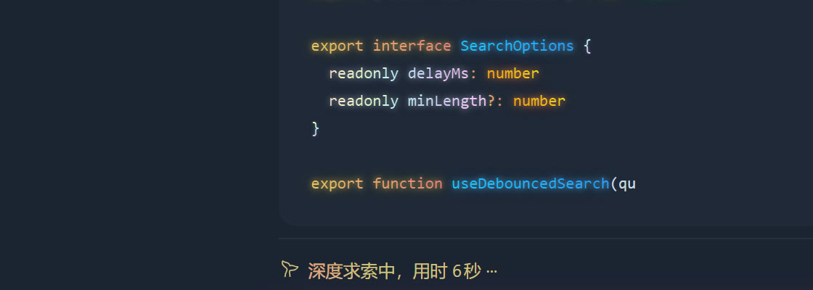 |  |
| 侧栏当前会话 | 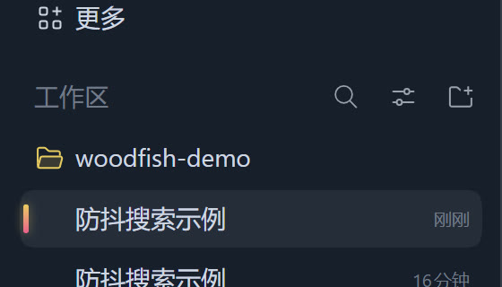 |  |
| 标签下划线 |  |  |
| 菜单毛玻璃与指针柔光 | 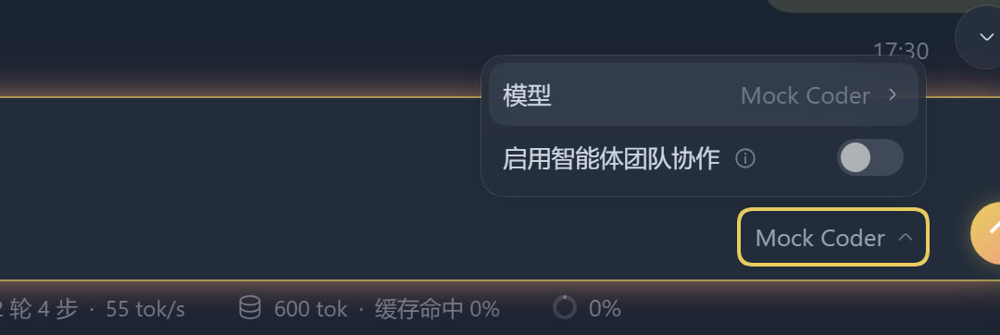 |  |
| 改动文件卡片（之前漏掉的卡片令牌） | 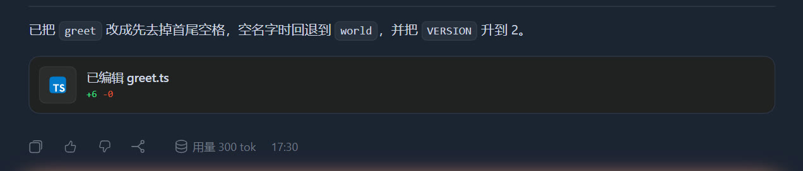 | 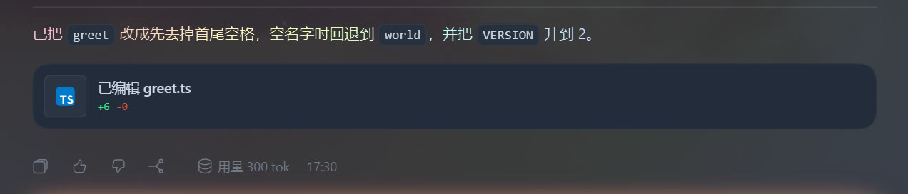 |

### 每套主题

dsh 原样：[深色](dsh-screenshots/themes/dsh-dark.jpg)、[浅色](dsh-screenshots/themes/dsh-light.jpg)。

| 主题 | 改前 | 改后 |
| --- | --- | --- |
| Woodfish Dark |  | 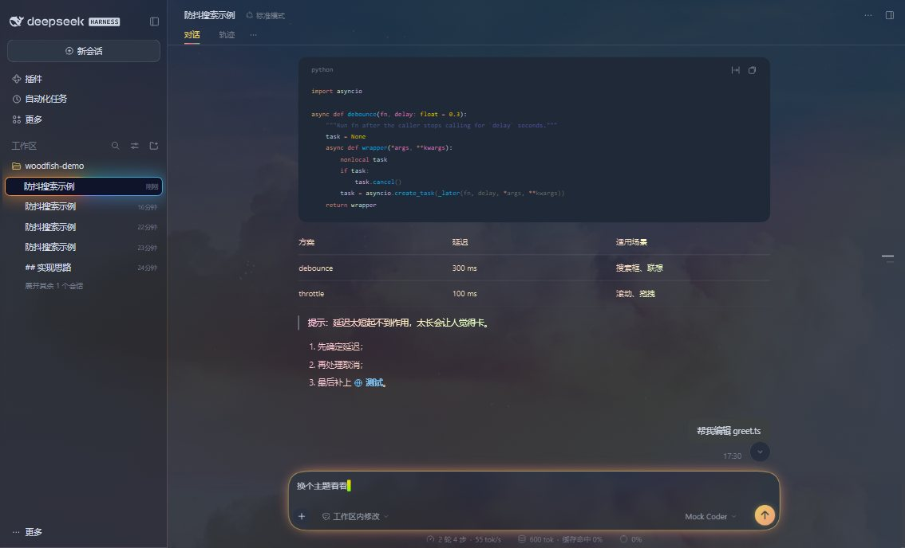 |
| Woodfish Dracula |  | 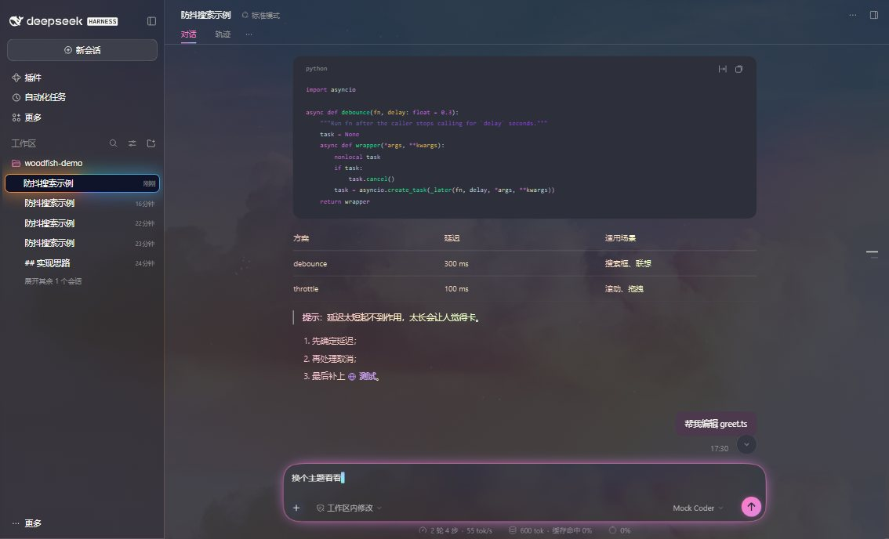 |
| Woodfish Light | 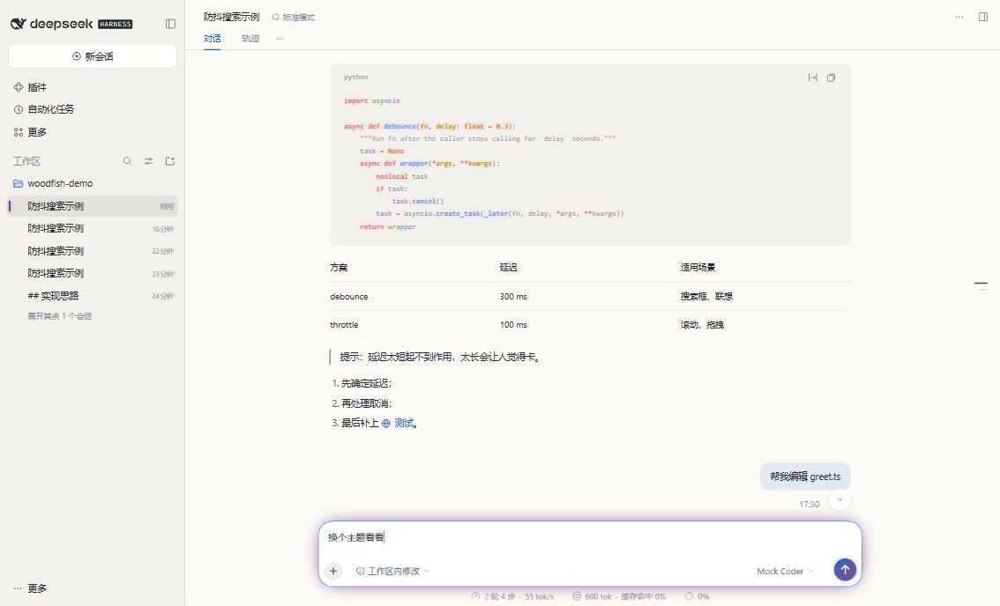 | 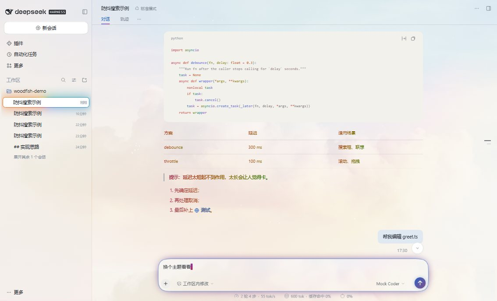 |
| Woodfish Black |  |  |
| Woodfish Neon |  | 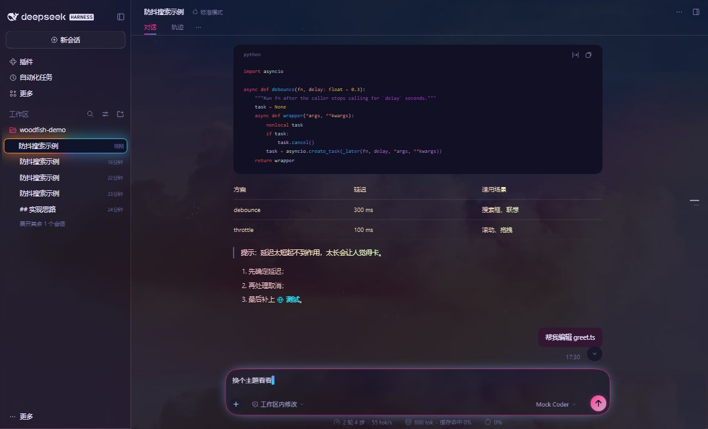 |
| Woodfish One Dark Pro | 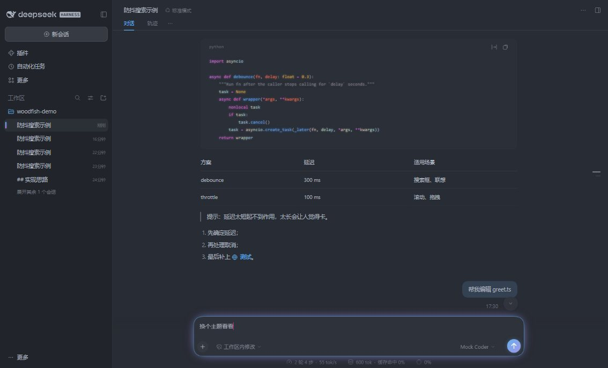 | 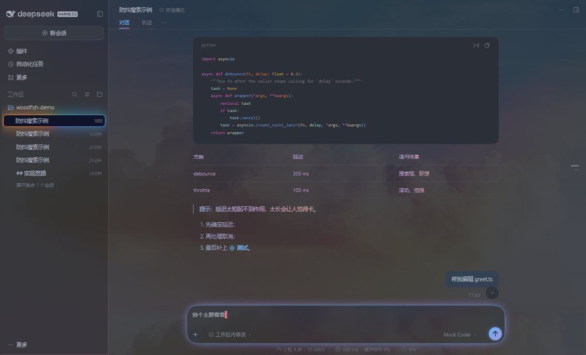 |
| Woodfish Tokyo Night | 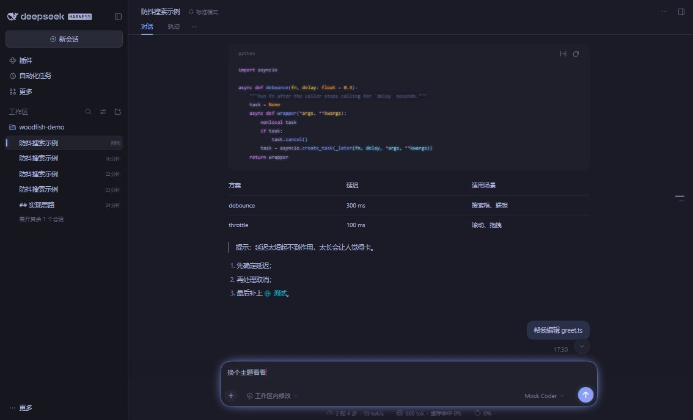 | 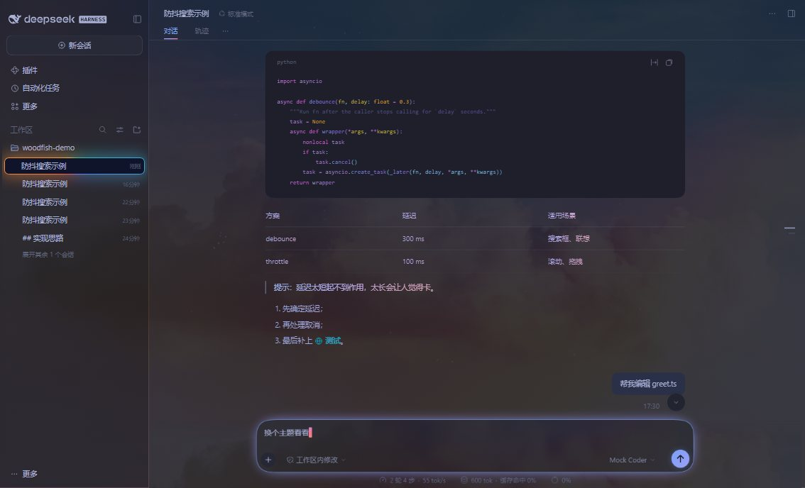 |
| Woodfish Catppuccin Mocha |  |  |
| Woodfish Catppuccin Latte | 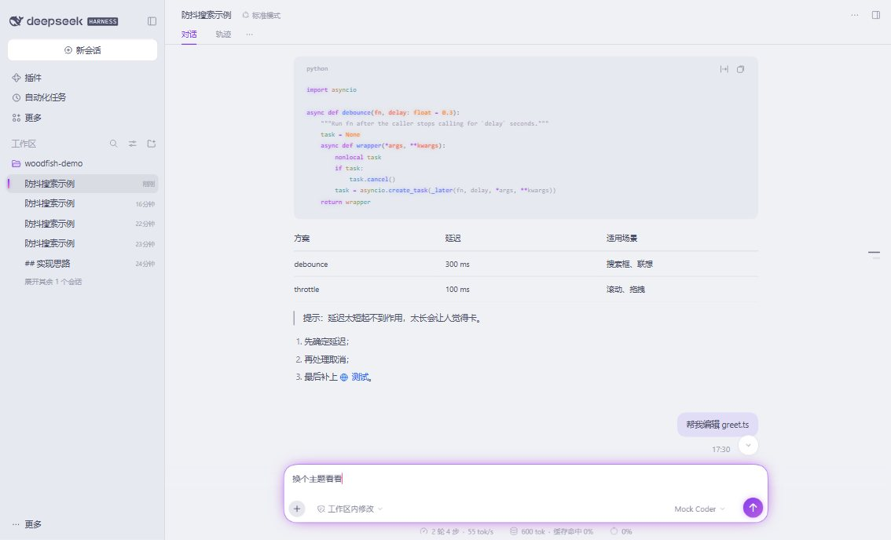 |  |
| Woodfish Nord |  | 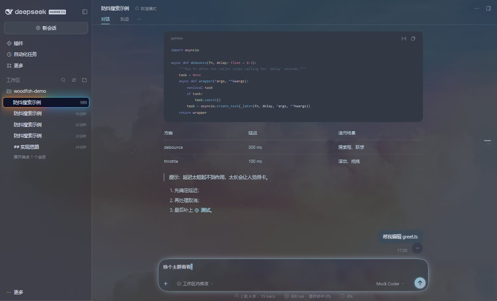 |
| Woodfish GitHub Dark | 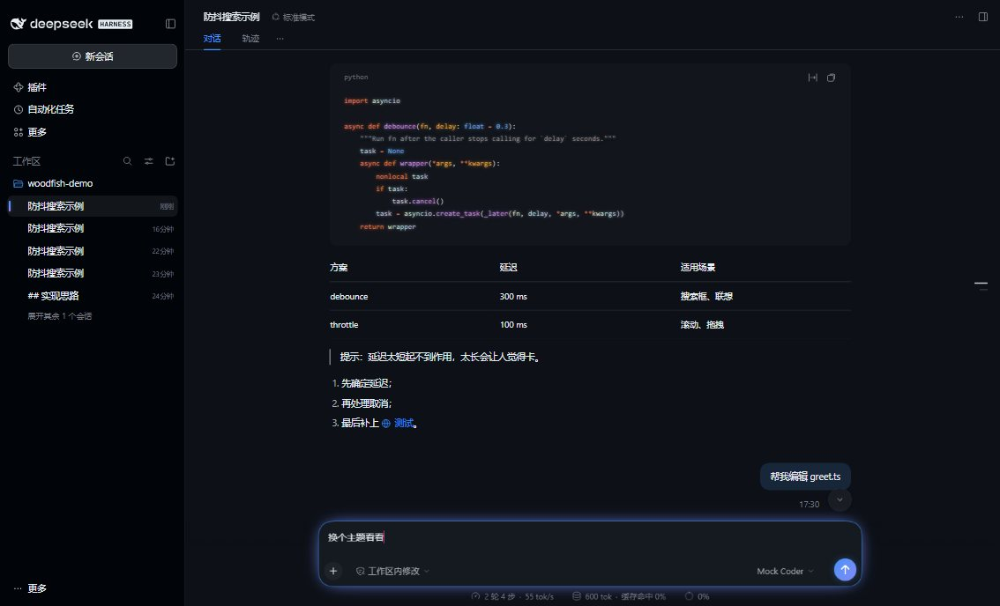 |  |
| Woodfish GitHub Light |  |  |
| Woodfish Night Owl | 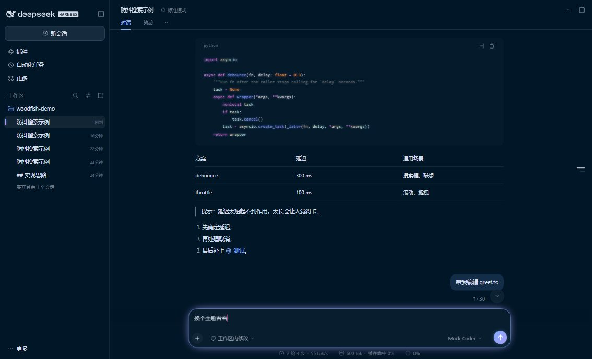 |  |
| Woodfish Ayu Mirage | 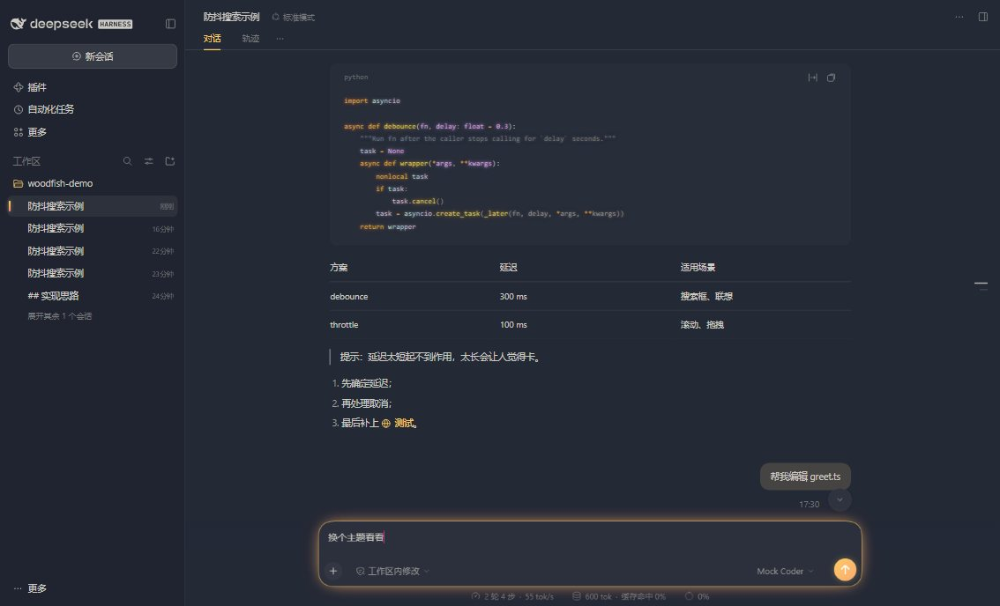 |  |
| Woodfish Gruvbox Dark |  |  |

在 Chromium 156 中用用户脚本菜单切换，输入框开启时为 49.84px 的 squircle，关闭后恢复 dsh 原生的 28px、`superellipse(1.5)`。

| 开启 | 关闭 |
| --- | --- |
|  | 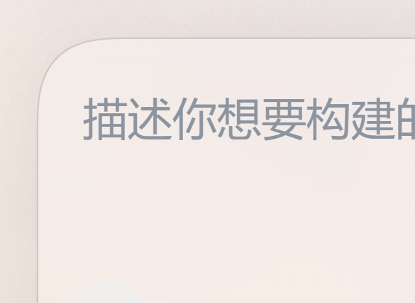 |
