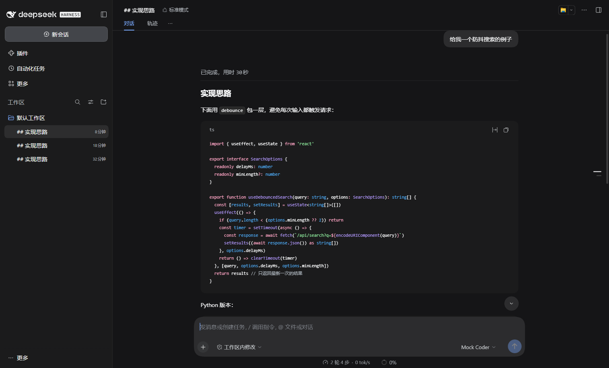
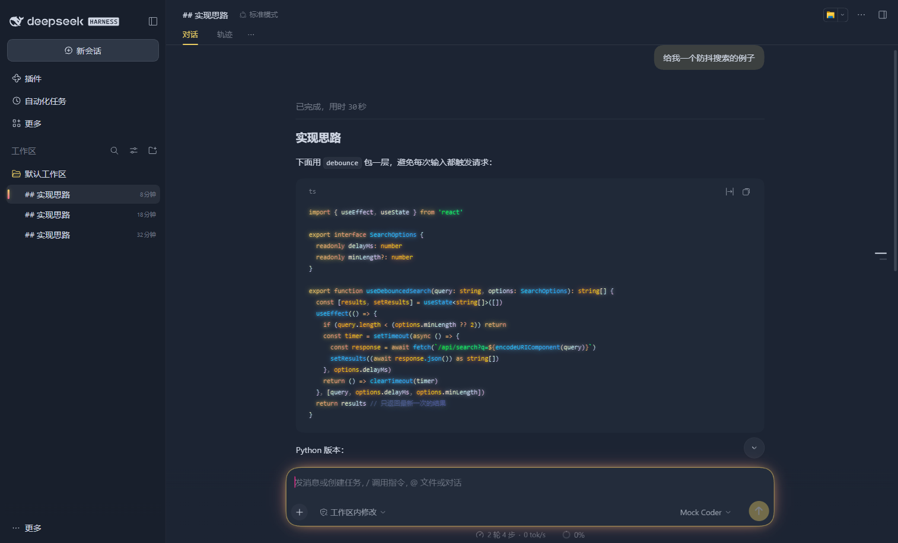
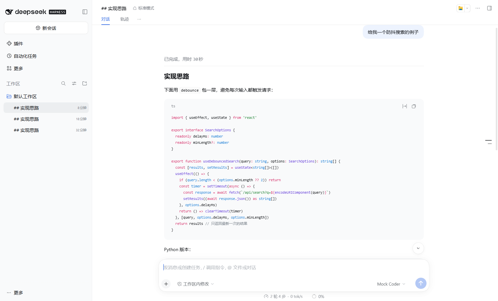
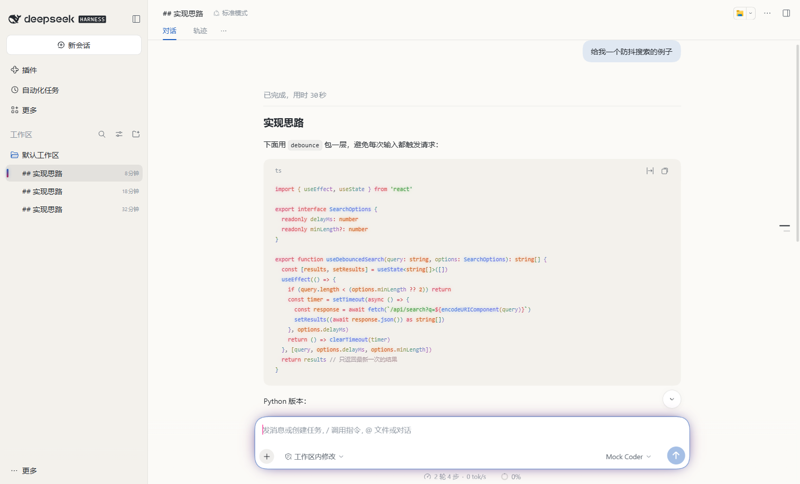

# DeepSeek Harness（dsh）Web 版适配说明

使用方法见 [apps/desktop-cli/README.md](../../apps/desktop-cli/README.md#deepseek-harnessdsh-web-版)。本文记录实测结论，供维护 `packages/adapter-dsh` 时参考。

实测环境：Windows 11，`@deepseek-ai/dsh` 0.2.2-rc.1（npm，需要 Node.js ≥ 24.9），Chromium 内核浏览器，实测日期 2026-11-13。

## dsh 是什么

- DeepSeek 开源的 agent harness（[deepseek-ai/deepseek-harness](https://github.com/deepseek-ai/deepseek-harness)，MIT），“一切皆插件”，基于 Cordis。仍是开发者预览版，官方说明会有不兼容的改动。
- **Web 版是本机服务，不是线上站点**：`npx @deepseek-ai/dsh web` 在 `http://127.0.0.1:3080` 起服务（`--port` 可改，`--tls-cert` 可开 HTTPS，`--public-url` 可放到反向代理后面），并用默认浏览器打开。首次打开的地址带一次性 `?token=`，之后靠 Cookie。
- 另有 DSH Desktop（Electron 桌面版）和终端模式，本适配不覆盖。
- 首次运行会在 `~/Documents/deepseek-harness/default-workspace` 建默认工作区，配置写在 `$DSH_HOME`（`profiles/web/cordis.patch.yml`、`.credentials.yaml`）。测试时用单独的 `DSH_HOME`，结束后把默认工作区一起清掉。

## 页面技术

| 项目 | 结论 |
| --- | --- |
| 框架 | React（`ui-renderer` 插件挂载），每个界面功能都是一个客户端插件 |
| 样式 | CSS Modules，类名带哈希（`uV2eYG_card`、`_block_7gxqk_4`），每个插件一个 `<style data-plugin>`；**不能用作选择器** |
| 配色 | 设计令牌三层：`--dsw-static-*`（固定色阶）→ `--dsw-alias-*` / `--dsw-specific-*`（语义）→ 组件。语义层定义在 `body`（浅色）和 `body[data-ds-dark-theme]`（深色）上，都不在 `@layer` 里 |
| 深浅色 | dsh 自己的“外观”设置（浅色 / 深色 / 跟随系统）切换 `body[data-ds-dark-theme]`；`<html data-ds-theme-source>` 记录偏好，由启动脚本在任何插件加载前写入 |
| 代码高亮 | Shiki，`css-variables` 主题：`pre.shiki > code > span.line > span[style="color:var(--shiki-token-*)"]`，9 个颜色槽位 |
| 浮层 | 菜单、弹出框都用 `background: var(--dsw-specific-menu)` + `backdrop-filter: var(--dsw-menu-backdrop-filter)`，本身就是毛玻璃；macOS 上 dsh 改成不透明（`html[data-platform="darwin"] body`） |
| 输入框 | Lexical 编辑器：`[data-composer-card]` > `[data-composer-input][contenteditable]`，光标色来自 `--dsw-alias-state-business-primary` |
| diff | 工具调用的编辑预览是 `[data-diff]` 卡片，按行渲染、没有语法高亮，增删色来自 `--dsw-alias-state-{success,error}-primary` 和 `--dsw-alias-code-diff-*` |
| Shadow DOM / iframe | 主界面都没有（右侧栏的网页浏览是沙箱 iframe，不处理） |
| CSP | 响应没有 CSP 头，`<style>` 可以直接注入 |

## 注入方式：油猴用户脚本

| 方式 | 结论 |
| --- | --- |
| **油猴用户脚本**（采用） | dsh Web 版就是用户自己浏览器里的一个本地网页，用户脚本是最自然的入口：不碰 dsh 的文件和配置，dsh 升级不受影响，任何端口、任何浏览器都能用；卸载就是在油猴里删掉脚本 |
| dsh 插件 | dsh 有官方主题扩展点（插件可以通过 `ctx.theme` 注册别名令牌覆盖），也能注入客户端代码。但插件 API 处于开发者预览、会有不兼容改动，要用 dsh 的工具链构建并装进 `$DSH_HOME` 的配置，渐变引擎照样要操作 DOM。等 API 稳定后可以再评估 |
| CDP | 需要用户带调试端口启动浏览器，代价和风险都比 Codex 大，没有必要 |
| 浏览器扩展 | 打包、签名、上架的成本远高于用户脚本，收益相同 |
| 改 dsh 的安装文件或 HTML | 禁止 |

用户脚本的头部（`apps/desktop-cli/scripts/build.js`）：

- `@match http://127.0.0.1/*`、`http://localhost/*`、`http://[::1]/*` 以及对应的 https。按 Chrome 的匹配规则，不写端口就匹配任意端口；Violentmonkey 直到 [#2716](https://github.com/violentmonkey/violentmonkey/pull/2716) 才这样处理，所以另加 `@include http://127.0.0.1:*/*` 等通配。放到反向代理后面的部署需要用户在油猴里自己加匹配网址。
- 脚本只在带 `html[data-ds-theme-source]` 的顶层页面启动，本机其他服务不受影响。`@noframes`、`@run-at document-end`（这时启动脚本已经写好标记）。
- `@grant GM_registerMenuCommand / GM_unregisterMenuCommand / GM_getValue / GM_setValue`：菜单里切换主题和效果开关，改动存进脚本管理器（不同端口共用）。没有这些 API 时退回页面的 localStorage。有了 `@grant`，脚本运行在隔离环境，看不到页面的全局变量（如 `__DSH_BOOT__`），所以识别页面只用 DOM 标记。

## 选择器与变量

选择器登记在 `packages/adapter-dsh/src/selectors.ts`，只用 `data-*`、ARIA role 和库的类名（`pre.shiki`、`.line`），测试会拦截任何其他类名。

| 分组 | 选择器 | 必须存在 |
| --- | --- | --- |
| dsh 页面 | `html[data-ds-theme-source]` | 是 |
| 主界面 | `[data-slot="root"]` | 是 |
| 当前会话 | `[role="tree"] [role="treeitem"][aria-selected="true"]` | 否 |
| 输入框 / 编辑区 | `[data-composer-card]` / `[data-composer-input]` | 否 |
| 发送按钮 | `[data-composer-card] button[aria-busy]:not([aria-haspopup])`（模型选择按钮也有 `aria-busy`，但带弹出菜单） | 否 |
| 助手回复 | `[data-chat-flow-kind="assistant-step"] [data-text-interaction-source]:not([data-message-bubble])` | 否 |
| 代码块 / token | `[data-code-block-content]` / `… pre.shiki .line > span` | 否 |
| diff 预览 | `[data-diff]` | 否 |

配色几乎全靠覆盖变量完成，不需要元素选择器：

- `buildPaletteVariables` 覆盖近百个 `--dsw-alias-*` / `--dsw-specific-*`：表面层级沿用 dsh 的做法（深色时层级越高越亮，浅色时用调色板的控件底色），边框、悬停仍是半透明的前景色，强调色、链接、状态色、diff 背景都换成调色板的颜色，用户气泡带一点强调色。
- `buildShikiVariables` 把 9 个 `--shiki-token-*` 对到调色板的语法角色。颜色和调色板完全一致，所以渐变引擎能查到 5 套内置主题的特调渐变。
- 作用域是 `:root:root body[data-ds-dark-theme]` / `:root:root body:not([data-ds-dark-theme])`：dsh 的变量块最高到 (0,2,2)（macOS 那条），插件样式又可能插在我们后面，所以靠特异性而不是顺序取胜，不用 `!important`。
- 毛玻璃只改 `--dsw-menu-surface-fill`、`--dsw-specific-menu`、`--dsw-menu-backdrop-filter` 三个变量，`prefers-reduced-transparency` 时退回不透明。
- 配色按 `WOODFISH_PALETTES` 通用遍历：每个模式默认取 theme-core 列出的第一套，菜单在该模式的全部主题和“dsh 自带配色”之间循环。theme-core 新增主题后，重新构建脚本即可出现，不用改适配器。

## 实测结论与坑

- ` ```typescript ` 代码块在 0.2.2-rc.1 里**不高亮**（停留在 `pre._plain_*`），` ```ts `、`tsx`、`javascript`、`python`、`bash`、`json`、`rust`、`go` 都正常。没高亮的代码块没有 token，只有配色变化，没有渐变。
- Shiki 的 `css-variables` 主题只有 9 个槽位：类型名和数字共用 `constant`（都取调色板的数字色），普通标识符用前景色。这是 dsh 选的高亮主题决定的，比 VS Code 里粗一些。
- 流式输出期间代码块先是纯文本，结束后才换成 Shiki 的结构；渐变引擎的 MutationObserver 会接住替换。
- diff 预览按行着色，没有 token，所以只换配色、不加渐变。
- 侧栏终端（xterm）有自己的主题快照，没有跟随调色板；文件类型图标的颜色来自 `--dsw-static-deepseek-*`，也没有换。
- 会话列表是虚拟滚动，早先的消息不在 DOM 里，截图前要先滚到目标位置。

## 怎么验证的

- 用 Node 24 在临时 `DSH_HOME` 里跑 `dsh web --no-open --port 3088`。
- 为了不花钱，模型用的是本机的 OpenAI Chat Completions 假服务（自定义模型 API，指向 `127.0.0.1`），固定返回带代码块、表格、引用的 Markdown，以及“读取 → 编辑”两步工具调用，用来生成真实的代码块和 diff 预览。脚本是一次性的，没有入库。
- 在真实页面里执行构建好的 `woodfish-dsh.user.js`（深浅色、5 套主题都切过），用桩函数模拟 `GM_*` 验证菜单的切换、存储和恢复默认，确认释放后样式、标记、`<html>` 上的 dataset 全部清除。
- **没有在真实的 Tampermonkey / Violentmonkey 里安装测试**（不在用户的浏览器里装扩展），`@match` 端口行为依据的是 Chrome 匹配规则文档和 Violentmonkey #2716。

## 截图

同一段对话，左边 dsh 原样，右边加上 Woodfish（默认设置：深色 Woodfish Dark、浅色 Woodfish Light）：

| | dsh 原样 | Woodfish |
| --- | --- | --- |
| 深色 |  |  |
| 浅色 |  |  |

- `dsh-screenshots/dark-menu-glass.png`：深色下的“访问模式”菜单，背后代码被毛玻璃模糊。
- `dsh-screenshots/dark-dracula-diff.png`：Woodfish Dracula 下的工具调用 diff 预览。
