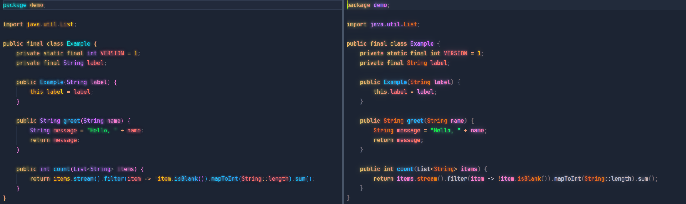
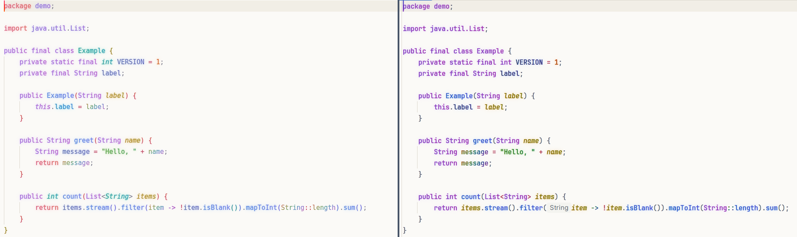
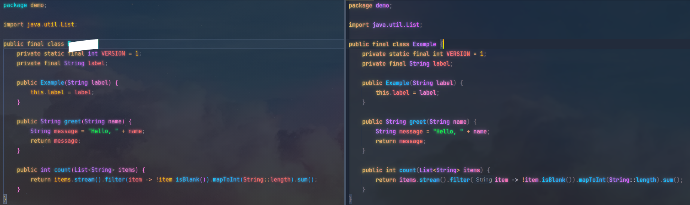
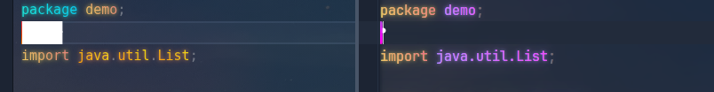
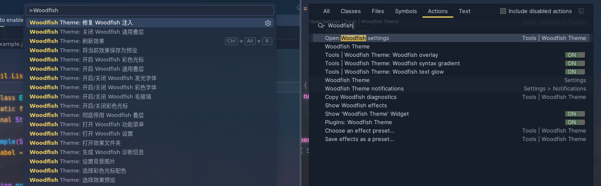

# JetBrains：15 套配色，加渐变与发光

[插件工程](../../apps/jetbrains) · [生成器](../../apps/jetbrains/scripts/generate.js) · [映射表](../../apps/jetbrains/scripts/scopeMap.js) · [属性名核实表](./jetbrains-keys.md) · [色值对照表](./jetbrains-colors.md)

`pnpm jetbrains:generate` 从 `WOODFISH_PALETTES` 枚举主题，按显示名找到 VS Code 扩展注册的主题 JSON，生成 `apps/jetbrains/src/main/resources/themes/woodfish-<slug>.xml`（编辑器配色方案）和 `.theme.json`（界面主题），并把每套主题的许可文本放进 `licenses/`。`pnpm jetbrains:check` 比较内容，检查多余文件和 `plugin.xml` 里的 `themeProvider`，不写文件。生成器也将 theme-core 色彩计算、光晕参数、色标、预设、光标默认值和内置输入效果编入插件，Java2D 使用这些产物绘制。

| 项目 | 做法 |
|---|---|
| 取色 | `themeMatch.js` 按 VS Code 分词器的规则对 scope 栈逐级取色：外层到内层，每层取最具体的规则，只覆盖该规则设置了的前景和字体样式。用 VS Code 自带语法和 `vscode-textmate` 对 15 套主题 × 8 种语言共 12 986 个 token 逐个对拍，结果 0 处不同。 |
| 属性 | `scopeMap.js` 每行是「JetBrains 属性名 → VS Code 里给同类 token 着色的 scope 栈」。多数语言属性回退到 `DEFAULT_*`，但父方案 Darcula / Default 和语言叠加文件（`PythonDarcula.xml`、`MarkdownDarcula.xml`、`XmlDarcula.xml`）显式定义了的属性不会回退，不覆盖就会漏出 Darcula 的颜色，所以都列出来。 |
| 属性名核实 | `scripts/audit-keys.py` 解析 IDE 发行包里的类常量池和配色方案 XML，记录每个名字在哪个产品、哪个版本里找到，写进 `scripts/verified-keys.json`；测试拒绝不在其中的名字。覆盖 IC 2024.1.7、IC 2025.2.6.4、IU 2026.3、PyCharm CE 2025.2.6.3、Go 插件 243 / 252 / 263、Rust 插件 233 / 262。新增属性时按 `--keys <文件> --merge` 只为新名字补记录。 |
| 界面主题 | 背景、前景、边框、选区、强调色来自调色板的 `ui`；控件保留当前外观的图标，并支持可切换的苹果圆角。 |
| 编辑器界面色 | 背景、前景、行号、当前行、选区、光标、搜索高亮、错误和警告取 VS Code 主题的同名颜色；主题没写时用 VS Code 的默认值，当前行没写时不填充。带透明度的颜色在编辑器背景上合成，JetBrains 的颜色不带 alpha。 |
| 默认文字色 | JetBrains 的 `TEXT` 同时是代码里没有专用键的标识符的颜色，取 VS Code 里 `source` 规则给普通代码的颜色，没有这条规则时用 `editor.foreground`。只有 Woodfish Dark 两者不同（`#AFBBD2` 与 `#D0D7E4`）。Markdown 正文用 `MARKDOWN_TEXT` 单独取 `editor.foreground`。 |
| 控制台和终端 | 16 色 ANSI 用 `palette.ansi`，与终端配色包同一份值（15 套主题的 VS Code `terminal.ansi*` 与它完全相同）：经典终端读 `CONSOLE_*_OUTPUT`，新终端读 `BLOCK_TERMINAL_*`，两组都写。背景是 `CONSOLE_BACKGROUND_KEY`，前景是 `CONSOLE_NORMAL_OUTPUT`，取主题的 `terminal.background` / `terminal.foreground`，没写时取调色板的 `ui.bg` / `ui.fg`（终端配色包同样如此）。`CONSOLE_ERROR_OUTPUT` 用 ANSI 红。 |
| diff | 新增、删除行底色取 `diffEditor.insertedLineBackground` / `removedLineBackground`（`DIFF_INSERTED`、`DIFF_DELETED`）。VS Code 没有「修改」色，改动行是左边删除、右边新增，所以 `DIFF_MODIFIED` 取 `editorGutter.modifiedBackground` 按新增行底色的浓度叠色。滚动条上的标记取 `editorOverviewRuler.*`。行号区的新增、修改、删除竖条（`ADDED_LINES_COLOR` 等）取 `editorGutter.*Background`。 |
| inlay 提示 | 类型提示（`INLAY_DEFAULT`）和参数提示（`INLINE_PARAMETER_HINT`）各取 VS Code 的 `editorInlayHint.type*` / `parameter*`，没写时回退到基础的一对，再没有就是 VS Code 的默认值（前景 #969696，背景是 `badge.background` 的 10 %）。 |
| 折叠 | `FOLDED_TEXT_ATTRIBUTES`：占位文字取 `editor.foldPlaceholderForeground`，背景取 `editor.foldBackground`（主题没写时是选区色的 30 %）。 |
| VS Code 默认值 | 主题没写的颜色取 VS Code 1.147 自己的默认值，规则读自它的 workbench 包，写在 `scripts/editorMap.js`。 |
| 嵌入语言背景 | Darcula 和 Default 给 Markdown 围栏、字符串里的嵌入代码铺了底色（`INJECTED_LANGUAGE_FRAGMENT`），VS Code 没有，覆盖为编辑器背景色。 |

## VS Code 效果在 JetBrains 上的对应方式

设置入口在 **设置 → 工具 → Woodfish Theme**。下表中的键省略了 VS Code 的 `woodfishTheme.` 前缀。设置页提供中文和英文。生成器从扩展清单读取开关、枚举、数值范围和默认值，从 theme-core 读取预设及各主题的光标参数。

| VS Code 效果与设置 | JetBrains 行为与验收点 |
|---|---|
| `overlay.enabled`、`syntaxGradient.enabled`、`glow.enabled`，默认开 | 总开关、渐变和发光可独立调整。编辑器语法配色、选区和系统光标仍由 IDE 管理。 |
| `overlay.style`、`hueShift / lightnessDelta / neutralChroma / angle`，默认 modern、32°、0.12、0.075、45° | 五套原创配色使用共享手调色标，未列出的颜色用同一个 OKLCH 函数推导。正文彩虹保留九色与专属角度。Classic 加粗，使用宽光晕。JetBrains 另有中日韩文字开关。 |
| `glow.intensity`，默认 1 | 现代光晕分层绘制，标点减弱，浅色底使用亮色光晕。Java2D 按编辑器字形和坐标栅格化。 |
| `cursor.enabled / gradientStops / animationDuration / borderRadius / glow / glowOpacity / glowBlur` | 彩虹光标默认开。基础值为九色、8 秒、2 px，光晕开、0.7、0 px。选择 Dracula、Light 等配色时读取各自的色标与周期，用户覆盖优先。支持多光标，宽度跟随原生编辑器。 |
| `effects.enabled` 默认开；`caretTrail.enabled` 默认关 | 启用后运行与 VS Code 同源的拖尾模块。`length / style / width / color / followTheme / opacity / sources` 默认 12、实心、6 px、白色、关、1、all。光标移动后丝带收拢，失焦停止绘制。 |
| `typingParticles.enabled` 默认关 | 同一模块生成粒子的数量、半径、初速、散射角、重力和寿命，默认 8、2.2 px、170 px/s、150°、450 px/s²、650 ms。`colors / color / sources` 默认 theme、白色、all。`shake` 默认关，开启后轻晃光标与粒子层，保持原生文字、选区和命中位置稳定。 |
| 拖尾和粒子的 `sources` | 同 VS Code 的 Monaco 监听器，编辑器提供 user 事件。all 和 user 响应用户输入。ai 只接受带 AI 标记的事件，平台没有跨助手统一的逐字流接口。 |
| `background.enabled / image / opacity / blur / mask` | 默认关，空路径选《彩云》，图片不透明度 0.15，模糊 10 px，主题蒙层 0.35。编辑器视口支持本地 JPEG、PNG 和 WebP。工具窗口和弹层分别由相应组件绘制，平台没有给第三方插件绘制整个工作台底图的统一接口。 |
| `glass.enabled / targets / opacity / borderRadius` | 默认关，全部目标、0.7、0 px。菜单、悬浮、补全、搜索、通知、查找框、下拉框、弹层、工具栏、工具窗口标题、对话框按当前外观公开的 UI 键透色。多个弹层可共用一个键，stickyScroll 保留编辑器实现。圆角 0 沿用当前主题。 |
| `glass.mode / blur / saturate / noise / animations / reveal` | VS Code 默认 blur、30 px、125%、0.02、开、开。Swing 原生弹层没有 CSS backdrop、滤镜链或每个列表项统一的动画层，使用主题透色和平台过渡。 |
| `glass.nativeWindow.enabled / windowsMaterial / macVibrancy / opacity` | VS Code 默认关、acrylic、under-window、0.78。IntelliJ Platform 的主题 API 不能设置操作系统桌面合成材质，设置页列出对应默认值。 |
| `squircleCorners.enabled`，默认开 | 以 Swing 外观的 `*.arc` 近似连续圆角，采用共用的 1.78 系数，保留小圆角、胶囊和圆形。关闭、卸载或换肤会恢复相应主题的原值。 |
| 内置与自定义预设 `presets.custom` | Woodfish 默认、柔和护眼、霓虹全开、怀旧（5.x）、毛玻璃、专注、性能七套直接读取共享预设。可保存、覆盖、删除个人预设。 |
| `syntaxGradient.customRules / glow.customRules / cursor.customRules`、用户 `user.css` 和 JS 热加载 | VS Code 的规则作用于 Monaco DOM，用户插件使用 Canvas、DOM 事件和按需导入。Swing/JVM 不提供这些对象。JetBrains 通过本地设置和预设即时更新，随包执行两个内置输入模块。 |
| `runtime.fixChecksums`、扩展修复、重新加载 | VS Code 的设置用于写入工作台后的校验。JetBrains 安装标准插件 ZIP，应用设置后重绘。 |
| 活动徽章、选中标签渐变边、主题装饰 | VS Code 在自己的工作台 CSS 中绘制。JetBrains 通过界面主题设置高亮、标签和选区色，标签页与图标的绘制由当前外观负责。 |
| 其他内置效果插件 | `accent / background / caret / code-gradient / glass / rainbow-text / squircle-corners / stream-cursor / text-reveal / thread-ring` 的清单指定 Codex、dsh。VS Code 的光标、背景、代码渐变、玻璃与圆角由其核心覆盖层提供。助手回复彩虹、吐字光标、新字淡入和会话边框属于聊天宿主。 |

代码清单见 `apps/vscode-extension/src/services/effects.ts`、`apps/vscode-extension/browser/effects.ts` 和 `packages/effects/builtin/*/effect.json`。Java 绘制桥只接收位置、色值和路径命令，编辑器文字留在 IDE 中。

## 安装与上架

- 市场编号 36347，vendor 为 Woodfish，stable 渠道，许可 MIT。版本在 JetBrains 人工审核通过后上架。[Marketplace](https://plugins.jetbrains.com/plugin/36347-woodfish-theme)
- 在 IDE 的插件市场搜索 Woodfish Theme，也可以从对应 GitHub Release 下载 ZIP 并选择“从磁盘安装插件”。
- 后续版本用 `./gradlew publishPlugin`（在 `apps/jetbrains` 下，JDK 21）上传，令牌从环境变量 `JETBRAINS_MARKETPLACE_TOKEN` 读（插件市场「My Tokens」里建的 Permanent Token，只放在 Windows 用户环境变量里，不进仓库、不打印）。每个新版本也要过一次审核；市场不接受重复版本号。
- 首次上传必须在网页上手动做（接受 Marketplace Agreement 与 Developer Agreement、建 vendor、传 zip、选许可和标签），之后不用再做。插件页的截图、许可链接、文档和问题反馈链接在页面上维护，不在 `plugin.xml` 里。

## 验收方法

### 编辑器效果实拍（2026-11-25）

每组图左为 VS Code 1.148.0、右为 IntelliJ IDEA Community 2025.2.6.4。两边打开同一份 `Example.java`，使用 JetBrains Mono 15 px、26 px 行高。分别从私有 Xvfb 的编辑区裁图，并以无损 WebP 保存。

| 场景 | 同码实拍 | 观察 |
|---|---|---|
| Woodfish Dark |  | 比较关键字、字符串和常规正文的渐变及光晕。变量的分类跟随各自语言服务。 |
| Woodfish Light |  | 两边保留浅底，文字周围呈亮色晕染。 |
| 《彩云》和光标 |  | 左右都使用 15% 图片、10 px 模糊和 35% 主题蒙层，编辑器范围决定图片裁切。 |
| 拖尾与粒子 |  | 在空行键入 `// Woodfish` 后移动光标。白色拖尾收拢，粒子飞散并消失。两端的随机粒子方向各异。 |
| 菜单和苹果圆角 |  | VS Code 使用命令面板，IDEA 使用 Find Action。Swing 显示当前外观的控件弧度。 |

JetBrains 的效果和七套预设可以在同一个设置页调整。[设置页实拍](./jetbrains-shots/settings.webp)

启动两个独立 Xvfb，分别设置 DISPLAY 和 XAUTHORITY，清除 WAYLAND_DISPLAY。在隔离的 IDEA 配置中从本次构建的 ZIP 安装插件，VS Code 使用临时安装副本和独立的用户数据、扩展目录。分别切换 Woodfish Dark、Light，收起面板和折叠后裁相同代码区域。背景和输入动效单独打开，VS Code 写入运行时后完整重启。设置菜单和预设通过 Tools → Woodfish Theme 检查。圆角恢复、主题色标和输入轨迹另外使用 JVM 测试检查。

### 静态配色的复测方法

- 所有窗口只在 WSL 里私有的 Xvfb 上打开：`DISPLAY=:77`（IDE）、`:78`（VS Code）、`:79`（PyCharm），并且 `unset WAYLAND_DISPLAY`，否则 WSLg 会把窗口画到 Windows 桌面上。
- IntelliJ IDEA Community 2025.2.6.4 打开带 JDK 和 Kotlin 标准库的项目，看 Java、Kotlin、JSON、Markdown；PyCharm Community 2025.2.6.3 看 Python。TypeScript、Go、Rust 的语言专用高亮需要付费 IDE，不截图，靠属性名核实表兜底。VS Code 1.147 只加载主题，不加载 Woodfish 扩展，没有背景图和任何特效；两边装的都是只含主题的包，JetBrains 一侧的渐变与发光关闭，只比配色。
- 两边用同一份代码、JetBrains Mono 15 px（字宽正好 9 px）、行高 26 px，编辑器区域裁成一样大。两边都用灰度抗锯齿：子像素抗锯齿的彩边会让取色出错。
- IDE 里关掉与配色无关的干扰：项目面板收起，意图灯泡、行号区图标、拼写和语法检查、内嵌提示、代码折叠、代码检查（语法级别）。光标放在第 1 行；Markdown 放在第 2 行，否则 Markdown 插件会把光标所在的标题当成「光标下的元素」铺上高亮色。
- 终端、diff、inlay、折叠、行号区竖条另拍：Hints.kt（Kotlin，带参数提示，折叠 `names`）加终端里用 `printf` 打出 16 个前景块和 16 个背景块；`idea diff` 打开两版 Java 文件（有新增、删除、修改各一处）；`Vcs.java` 在一个 git 仓库里与最后一次提交不同。块的颜色在截图里逐个取，行与行之间的位置不写死：先找到那一排 16 个与调色板相近的色块再取色。
- 每张截图落盘后检查项目面板是否真的收起，没收起就翻一次 `Ctrl+Shift+F12` 重拍；再测量代码起点的 x 坐标，75 张 IDE 截图的起点一致，才拿去合成和取色。
- 色值对照不靠眼看：用 VS Code 自己的分词器算出每个 token 应有的颜色，再从两张截图里取同一个字符格的颜色（离背景最远的像素），一致就是 JetBrains 里实际显示的颜色等于 VS Code 的颜色。结果见 [色值对照表](./jetbrains-colors.md)。
- 2026-11-25 的最终 ZIP 通过 IC 2024.2（242.20224.300）、IC 2024.3.7（243.28141.18）、IU 2026.3.0.1（263.7307.353）的 Plugin Verifier 检查，三份报告均为 Compatible。前两版各提示 11 处实验 API，新版提示 9 处实验 API 和 1 处弃用 API。
- JetBrains 的坑：`bin/idea` 原生启动器不认 `IDEA_PROPERTIES`，用 `idea.sh`；PyCharm 读的是 `PYCHARM_PROPERTIES`；PyCharm 每次启动都会问是否信任目录，需要点掉；首次启动新界面会把主题重置成默认，要先空跑一次再写 `laf.xml`；`options/*.xml` 的文件名或属性名写错时 IDE 不报错，只是不生效，新设置要用 IDE 类文件里的真名核对（`audit-keys.py` 的扫描思路同样适用）；`pkill -f` 的模式会匹配到调用它的 shell 自己。

## 没有映射的

控制台里的 system / user-input 输出色、diff 的冲突色、inlay 提示正在输入时的高亮（`INLINE_PARAMETER_HINT_CURRENT` / `_HIGHLIGHTED`）、终端选区、调试器和 VCS 日志的颜色：VS Code 里没有一一对应的颜色，不凭空造，这几项仍然是 Darcula / Default 的。

## 已知差异

IDE 自己的渲染：inlay 方块的底色以约 55 % 不透明度绘制（Dark 的 #2B3343 实际画成 #242C3B），有词级差异的修改行，整行底色被冲淡，词级片段才是方案色。默认设置下行号区不画「删除」标记，`DELETED_LINES_COLOR` 在截图里看不到。类型提示没有在截图里出现（Kotlin 对 `val` 的类型提示只在类型不明显时才显示），`INLAY_DEFAULT` 的值取法与参数提示相同，没有单独的实拍。

JetBrains 按语法树着色，VS Code 按文法的 scope 着色。下面这些情况下 JetBrains 没有对应的细分属性，选了最接近的一个：

- 类声明和类引用共用一个类名属性（VS Code 里声明和引用可以不同色）。
- `import` 和 `package` 后面的名字用类名属性。
- 基本类型（`int`、`void`）、`true`、`false`、`null`、`None` 都算关键字。
- 修饰符、`class`、`def`、`import` 都是关键字，VS Code 的主题可以分开着色。
- 点号前的限定名：VS Code 按位置着色，JetBrains 按语义（类、字段、参数）着色。
- `self`：形参和函数体里的 `self` 共用 `PY.SELF_PARAMETER`，取函数体里的颜色。
- JSON 的属性名只有一个属性，VS Code 的个别主题按嵌套层级着色。
- Kotlin：VS Code 没有内置 Kotlin 语法，对比用的是社区文法，只按位置粗略着色。

每类差异各有多少处见 [色值对照表](./jetbrains-colors.md)。
