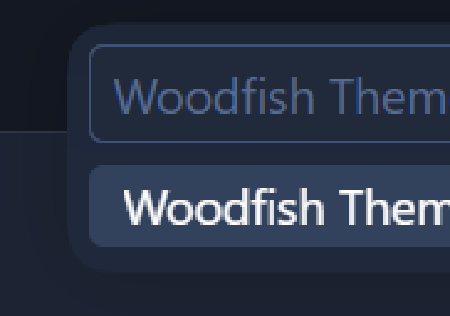
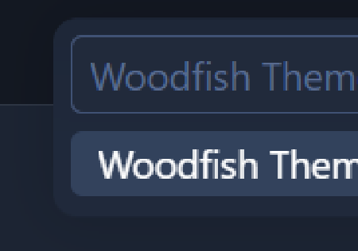

# VS Code 扩展适配说明

VS Code 扩展位于 apps/vscode-extension，发布为 Marketplace 和 Open VSX 上的 zhongjun.woodfish-theme。

- 构建：在仓库根目录运行 pnpm compile，再按需运行 pnpm runtime:build、pnpm themes:generate。
- 测试：运行 pnpm test 和 pnpm test:integration；发布前运行 pnpm pre-publish。
- 产物：编译文件留在 apps/vscode-extension/out，VSIX 输出到仓库根目录 dist/。
- 注入：扩展通过 workbenchPatcher.ts 管理 workbench.html 的受保护注入，并在卸载时恢复原文件。

## 苹果圆角

VS Code 设置 `woodfishTheme.squircleCorners.enabled` 默认开启，快速选择框和 Woodfish 毛玻璃浮层使用平滑圆角。切换走现有工作台补丁与校验和更新流程，完全退出并重开编辑器可看到新设置。

VS Code 1.147.0（Chromium 150）的独立扩展宿主完成了开启、关闭和再次开启测试。每次切换后，工作台文件与 `product.json` 记录的校验和一致。两种状态完整重启后均未报告安装损坏。

| 开启 | 关闭 |
| --- | --- |
|  |  |
